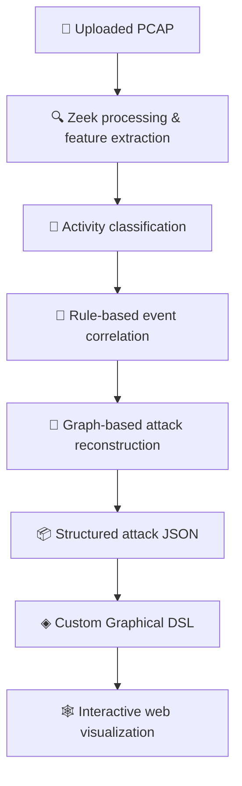

# ◈ ThreatForge

### Reveal the path. Understand the attack.

**Post-Incident Network Attack Reconstruction & Visualization**

Turn captured network evidence into an explorable story of what happened.

---

## 🔎 Overview

**ThreatForge** is a web-based system designed for post-incident network attack analysis and reconstruction. It processes previously captured PCAP files to extract network information, identify involved network assets, and classify supported security-related activities using Machine Learning. Through rule-based event correlation and graph-based reconstruction, the system connects related Security Events to reconstruct the attack progression supported by the available network evidence.

At the core of ThreatForge is an original Graphical Domain-Specific Language (GDSL) designed to represent reconstructed attacks through an interactive, asset-focused Attack Graph and Chronological Timeline. The visualization highlights involved Network Assets, their observed or inferred roles, associated security activities, relationships, and attack stages, while allowing users to inspect supporting evidence and understand how the attack may have progressed across the network.

ThreatForge is intended for Security Analysts, Students, and Instructors, supporting both post-incident investigation and cybersecurity education through detailed analysis, simplified visualizations, and predefined attack scenarios**.

> **Scope:** Post-incident analysis only. Traceveil is not a live network monitor, intrusion prevention system, or vulnerability scanner.

## ✨ What We're Building

| | Capability | Purpose |
|:--:|---|---|
| 📁 | **PCAP ingestion** | Analyze network traffic captured before upload. |
| 🧠 | **ML-assisted classification** | Identify supported network activities from extracted features. |
| 🔗 | **Event correlation** | Connect related events using time, assets, and network context. |
| 🧩 | **Attack reconstruction** | Build an evidence-based view of attack progression. |
| ◈ | **Custom Graphical DSL** | Define consistent meanings and visual rules for assets, events, and relationships. |
| 🕸️ | **Interactive exploration** | Inspect attack graphs, timelines, and supporting details. |
| 🎓 | **Learning views** | Support analysts, students, and instructors with different levels of detail. |

*These are planned project capabilities; implementation and evaluation are ongoing.*

## ⚙️ How It Works

## 🛠️ Adapted technology

| Area | Tools / approach |
|---|---|
| Network processing | Zeek |
| ML & data processing | Python, scikit-learn; Random Forest with XGBoost for comparison |
| Correlation & reconstruction | Rule-based logic, NetworkX |
| Frontend | React, TypeScript |
| Graph rendering | React Flow |
| Data exchange | Structured JSON |
| Domain visualization | Original Graphical DSL |

## 🧪 Evaluation

The system will be assessed using controlled attack scenarios and known ground truth. Evaluation focuses on classification performance, event-correlation quality, reconstruction accuracy, and the interpretability and usability of the resulting visualization.

## 🚧 Current Status

**In development.** This repository documents the design and implementation of a Computer Science graduation project. Setup instructions, screenshots, demos, and measured results will be added when they are available.

## 🎓 Academic Context

Developed as a **Computer Science Graduation Project** at **Taibah University** (academic year **2026–2027**).

---

*From network evidence to a clearer picture of the attack.*

