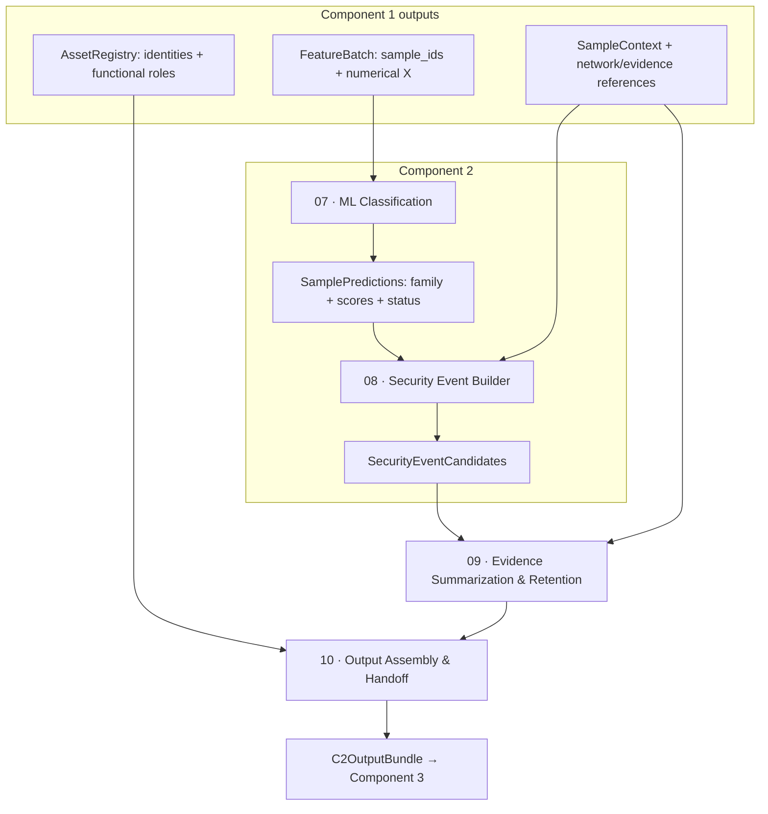

# ML Classification Design — Component 2

## 1. Introduction and Design Objectives

Component 2 converts structured observations of network behavior into activity classifications and evidence-linked Security Event Candidates. It operates after network processing: Component 1 supplies the numerical representation, sample identities and network context; Component 2 applies a fitted classifier and organizes compatible predictions into a useful downstream unit. It does not parse packets, derive new traffic measurements or discover assets.

A numerical classification is useful because a historical capture can contain many ordinary communications alongside several security-relevant activities. Individual packets provide insufficient behavioral context, while isolated connection records can fragment activity distributed across many contacts. The selected input is therefore a directed 10-second observation sample whose features include local measurements, source-wide context and neighboring activity. The classifier maps that representation into four supported activity families. It does not establish authorization, malicious intent or successful compromise.

Three units remain distinct. An **Observation Sample** identifies measured traffic for one directed pair, protocol and time bin. A **Sample Prediction** associates that sample with a model-selected family, scores and classification status. A **Security Event Candidate** groups compatible predictions while preserving their actual source records, targets and time boundaries. Several samples can support one event; one event is still not a complete attack sequence.

This distinction is necessary for downstream analysis. Component 3 needs events whose identities, endpoints and evidence can be inspected, rather than a list of unexplained class names. Component 4 can subsequently organize supported event relationships. Component 2 supplies the activity candidates without asserting those relationships itself.

The unified stage terminology and ownership are:

| Stage | Name | Responsibility |
| --- | --- | --- |
| 01 | Capture Identification | Component 1 |
| 02 | Network Processing & Measurement Policy | Component 1 |
| 03 | Parsing & Normalization | Component 1 |
| 04 | Observation Sampling | Component 1 |
| 05 | Feature Engineering | Component 1 |
| 06 | Asset Discovery & Functional Role Inference | Component 1 |
| 07 | ML Classification | Component 2 |
| 08 | Security Event Builder | Component 2 |
| 09 | Evidence Summarization & Retention | Shared integration |
| 10 | Output Assembly & Handoff | Shared integration |



SampleContext and AssetRegistry are separate from the numerical matrix. Asset discovery and service-function inference do not wait for an attack prediction. The stages shown after classification retain and package results; they are not additional ML algorithms. Detailed packet measurement and feature equations are specified in the accompanying [Component 1 design](<Network Processing Design_Component 1.md>).

## 2. Dataset and Activity-Class Design

### 2.1 Classification objective

The learning target is **observable network activity at family level**. A family can contain several producer subtypes with related network manifestations, but its name does not imply that the model identifies each subtype separately. Port contacts, repeated service traffic and denial-of-service-associated activity have different structural requirements; grouping them into one generic malicious label would discard useful event meaning. Conversely, promoting every scenario name into a separate class would require distinctions and independent examples that the available evidence does not establish.

The classifier is closed-set: every eligible sample receives a preference among the four supported families. `UNCERTAIN` expresses a low selected-class score, not a separately learned unknown-attack class. Unsupported behavior can receive a confident in-scope prediction. Interpretation therefore depends on coverage, evidence and the limits of the development evaluation.

### 2.2 Dataset requirements

The deployed input is an uploaded historical PCAP/PCAPNG, so training data must permit the same network representation to be regenerated. Required properties include accessible source captures, usable offline Zeek output, source-qualified activity annotations, benign references, timestamps and directed endpoint information. Sample-to-record lineage is needed to inspect both labels and later predictions.

An exported labeled row alone is insufficient when its feature definitions, aggregation interval or relationship to packets differ from the deployed measurements. The training representation must use the same packet-time counters, grouping, contextual features and preprocessing as inference. Annotation quality and measurement reproducibility are separate requirements: readable packets do not automatically establish correct training labels, and useful labels do not prove exporter equivalence.

### 2.3 Dataset selection

GeNIS supplies eleven locally processed captures: eight attack-scenario recordings and three benign references. Its available original annotations specify activity intervals and optional endpoint, transport and port selectors. Those selectors support a conservative annotation-to-Zeek adaptation using actual observation spans. They do not require one Argus/HERA row to equal one Zeek connection or sample.

| Dataset | Relevant available support | Limitation for this classification design |
| --- | --- | --- |
| GeNIS | Original PCAPNGs, regenerated Zeek observations, interval/endpoint selectors and separately identified benign profiles. | Generated scenarios and sparse independent subtype replication limit generalization claims; only source-qualified contributions receive supervised targets. |
| CTU-IDSEVAL-6 | Accessible selected captures and verified associations with native connection annotations. | `Malicious`, `Benign`, `Background` and `From_Malware` do not uniformly define specific observable activity classes. Some selected captures use 1970-based clocks, which must remain unchanged. |
| ToN-IoT | Network captures, native/structured material and original activity categories. | The inspected raw/native/prepared-label chain retains unresolved join and timestamp-conversion questions; matching category strings alone does not establish sample-level transfer. |
| UWF-ZeekData24 | Structured Zeek-derived exports and activity/ATT&CK annotations remain useful for schema and label research. | Team-inaccessible raw captures prevent independent reproduction of this packet-time inference representation; structured annotation meaning is not automatically a network sample label. |

GeNIS is used as the primary source because it permits one reproducible measurement/annotation path without combining incompatible dataset label spaces. This choice does not certify its complete producer pipeline or establish that the other datasets have no limited research uses.

Attack-scenario files are mixed recordings. The SMB recording, for example, contains separately annotated DNS reconnaissance, Nmap-related probing and SMB-related activity. The filename is never assigned to every connection. The eight recordings collectively contain embedded stages and more original subtype strings than recording names; capture count, subtype count and independent action count are different quantities.

### 2.4 Activity-class definitions

| Activity family | Network behavior | Relevant dataset labels | Interpretation limits |
| --- | --- | --- | --- |
| `BENIGN` | Traffic qualified by an explicitly documented benign profile and corroborating source tuples. | `benign-admin`, `benign-background`, `benign-user` in the producer benign representations. | Does not mean every unmatched observation is benign or that these references exhaust legitimate service behavior. |
| `PORT_PROBING` | TCP contacts whose grouped observations expose port/target contact patterns. | `recon-nmap`, with non-TCP discovery companions excluded from port-behavior training admission. | Does not prove intent, tool identity, open ports, exploitation or success. |
| `REPEATED_SERVICE_ACTIVITY` | Repeated observations of service-associated communication supported by the original activity selectors. | `bruteforce-smb`, `bruteforce-ssh`, `bruteforce-ftp`. | Does not equate connection count with authentication attempts, guessed passwords or successful logins. Legitimate repeated service use can resemble it. |
| `DOS_ACTIVITY` | Producer-annotated denial-of-service-associated traffic, represented through volume, direction, persistence and timing. | `dos-hulk`, `dos-udp`, `dos-icmp`, `dos-pushack`, `dos-slowloris`. | High-volume floods and low-rate persistent activity are not identical behaviors. A family prediction does not prove service outage or reliable recognition of every subtype. |

`recon-dns` is preserved as original network/annotation context but maps to no fifth model class. An associated DNS observation is not defaulted to `BENIGN` simply because it has no target-family mapping. Original subtype strings remain in training/evaluation sidecars even when several map to one family; these sidecars do not enter the runtime numerical matrix.

## 3. Training Data Preparation

### 3.1 From network capture to training sample

Component 1 processes captures offline with Zeek and emits compact per-UID/per-bin packet observations. The sample grouping key is:

```text
(capture_key, orig_h, resp_h, proto, bucket)
```

The bucket is an absolute, half-open 10-second interval. Ports and labels are absent from the key, allowing many-port contacts and mixed service observations to be represented without constructing groups from their desired targets. Lifetime connection counters are not placed into the start bin as if all traffic occurred there. Long-lived UIDs contribute only their actual packets and IP bytes to each populated bin.

Raw pair measurements capture starts, port diversity, directional volume, UID participation, carry-in and observation spans. Stage 05 adds source-wide unanswered-contact context and seven-bin temporal context spanning offsets −30 through +30 seconds. All valid observation windows contribute context, including valid partial-edge or non-training windows. The source-wide rule does not itself label attacks; its effective values remain separate from additive raw measurements.

This representation addresses two concrete limitations of isolated connections: repeated activity can be split across many rows, and ongoing traffic can extend beyond its connection-start bin. It also retains the source/target direction and evidence membership needed for event construction. The fixed 10-second width is a system representation, not a claim that a broad window search established a universal optimum.

### 3.2 Training label alignment

Original selector rows provide `StartTime`, `LastTime`, `Proto`, `SrcAddr`, `Sport`, `DstAddr`, `Dport` and `Label`. Each nonempty selector attribute is a required predicate. Empty attributes are unconstrained; they are not guessed from a scenario title. Source identity is bound through the capture manifest and hashes, and only relevant original time scopes are considered.

Annotation adaptation is performed on UID/bin contributions before sample-level purity is determined. The time predicate uses actual first/last observations rather than nominal bucket membership alone. To preserve the original nanosecond intervals, the logged observation clock is decoded to its microsecond quantization cell. Specifically, let $q(t)$ be the logged time rounded to microseconds with decimal round-half-even and then expressed in nanoseconds. For a UID/bin's first and last observation times $t_f,t_l$, define the inclusive possible observation range:

$$
[L,H]=[q(t_f),q(t_l)+999].
$$

Let $[A_j,Z_j]$ be original annotation $j$'s nanosecond interval. A possible overlap requires $L\le Z_j$ and $H\ge A_j$ in addition to all supplied tuple predicates. Direct conservative admission requires exactly one possible selector, exactly one containing selector, and:

$$
L\ge A_j\quad\land\quad H\le Z_j.
$$

Overlapping different original labels produce conflicting support rather than a forced majority. A boundary-only or otherwise partial scope remains uncertain. There is no automatic ±1-second expansion, timestamp shift or row-order join.

Two previously established packet-scope proofs can resolve selected conservative boundary cases. A reused UID/bin proof must match exact native lineage, directional counter closure, bucket, first/last clocks and contribution counts. A whole-connection proof requires uniquely matched native tuple/time/counters, source packet bounds contained by the original selector, and bin observations within that proven scope. Such proofs are reused only where their identifying conditions close; a connection label is not blindly propagated to all future bins.

Benign admission is separate: the capture must have explicit producer benign-profile support, its directed TCP/UDP tuple must appear in that source's benign export, and no possible attack selector may overlap the contribution. Absence of an attack match alone is insufficient. This is a documented source-specific adaptation to Zeek observations, not an assertion that the original flow exporter and Zeek produce equivalent rows.

### 3.3 Training eligibility and inference eligibility

At sample level, all contributing observations are assessed before the family target is assigned:

| Label status | Actual aggregation meaning | Supervised use |
| --- | --- | --- |
| `PURE` | Every contributor is source-qualified and all map to the same supported family. | Potentially eligible, subject to measurement and approved admission checks. |
| `MIXED` | More than one family is present or a contributor has conflicting original-label evidence. | Excluded; no majority replacement. |
| `UNMATCHED` | All contributors lack a qualified matching source scope. | Excluded; never assumed benign. |
| `UNKNOWN` | Other incomplete/boundary/unsupported combinations, including mixtures of qualified and unqualified support. | Excluded; retained as uncertainty/context. |

A family-pure sample can preserve more than one original subtype. In particular, SSH and FTP contributions can share `REPEATED_SERVICE_ACTIVITY` without being independent episodes or separate subtype-specific samples.

`inference_eligible` depends only on observable sample validity: required identifiers, valid same-family IP endpoints, supported protocol, aligned bin, finite ordered observed times, nonnegative consistent measurements, positive packet/UID participation, complete processing, resolved direction and a complete nominal capture bin. Valid partial-edge bins can remain `context_eligible` without receiving a prediction.

`training_eligible` additionally requires the original approved training-candidate flag, a `PURE` source-qualified supported family, nonempty original subtype tuple and selector provenance. The retained admission policy excludes capture-edge bins, negative recorded connection age, unverified IPv6 training parity and ICMP Nmap discovery as port behavior. Partition selection is applied after admission. The training-only flag is not consulted by feature construction, runtime inference or the Security Event Builder.

The evaluation-only truth gate uses the same source-qualified supervised admission. A runtime-eligible sample can therefore have a prediction but no evaluable truth. Such samples are reported separately and excluded from confusion matrices, not counted as benign or prediction errors by assumption.

### 3.4 Numerical input representation

For $N$ eligible samples, Component 2 receives:

$$
X\in\mathbb{R}^{N\times23},\qquad X\text{ stored as NumPy float64}.
$$

`FeatureBatch.sample_ids` fixes row identity; `X` contains the numerical features. Aligned `windows` provide enriched SampleContext. The other physical batch fields preserve all context windows, assessments and ID-indexed contextual vectors. `feature_names` and `feature_spec_version` are associated model/specification metadata, not extra physical fields of the six-field batch. The version is `obs23-behavioral-rf-v2`.

The following groups list all feature names in their exact model order. Their complete equations belong to Stage 05 in the Component 1 chapter.

| Positions | Ordered feature names | Classification relevance |
| --- | --- | --- |
| 1–3 | `eff_uids`, `eff_new_starts`, `eff_probed_endpoints` | Contact scale, repeated starts and new-port diversity with source-wide context when activated. |
| 4–7 | `eff_orig_pkts`, `pair_resp_pkts`, `eff_orig_bytes`, `pair_resp_bytes` | Volume and direction; responder measurements remain pair-local. |
| 8–11 | `carry_in_fraction`, `max_uid_age_s`, `mean_uid_span_s`, `sample_span_s` | Persistence and actual observation spread. |
| 12–14 | `is_tcp`, `is_udp`, `is_icmp` | Fixed transport indicators. |
| 15–19 | `eff_resp_pkt_share`, `eff_resp_byte_share`, `eff_bytes_per_orig_pkt`, `eff_pkts_per_uid`, `eff_ports_per_start` | Smoothed directional balance, size and contact-diversity relationships. |
| 20–23 | `eff_active_bins_70s`, `eff_sum_starts_70s`, `eff_max_uids_70s`, `eff_sum_pkts_70s` | Offline neighboring-bin activity with the implemented current-effective lower bounds. |

The `eff_uids` source-wide lower bound uses unanswered connection starts, not a literal union of source-wide UIDs. `eff_probed_endpoints` uses per-target new-port diversity sums, not a global distinct target count. These contextual representations must not be reinterpreted as additive event evidence.

Sample IDs are ordered deterministically; neither predictions nor evidence may be aligned through an independently sorted list. Empty input retains shape `0 × 23`. Component 2 does not append new service/role columns or recompute the numerical definitions for an uploaded capture.

### 3.5 Preventing data leakage

The numerical matrix excludes raw IP addresses, port numbers, Zeek service names, capture filenames/identity, absolute timestamps, original labels, subtype/selectors, partition metadata and evidence references. Protocol indicators and port-diversity counts describe behavior rather than raw identity. Source/target/port/time/service information remains available outside `X` for interpretation, target membership and evidence assembly.

Training labels and subtype weights are stored in a separate training/evaluation path. Runtime receives the observable representation and fitted artifact. Context construction retains valid windows even when their labels are mixed or absent, preventing training admission from changing the features available at inference.

This separation blocks direct label/source-column leakage, but cannot eliminate behavioral shortcuts. Tool-generated packet patterns, transport, service behavior and repeated scenario templates can still distinguish recordings more easily than general activity semantics. Evaluation therefore examines subtype/capture support in addition to aggregate scores.

### 3.6 Dataset partitioning

The fixed development split keeps every stage from a capture together:

| Partition | Capture identifiers | Purpose |
| --- | --- | --- |
| Training | `admin`, `background`, `smb`, `ssh`, `hulk`, `slowloris`, `icmp` | Fit preprocessing and the single deployed classifier using admitted samples only. |
| Held development | `user`, `ssh_ftp`, `udp`, `pushack` | Measure capture-disjoint development behavior with the fitted artifact. |

Adjacent windows and different stages of the same recording do not cross the partition. This prevents the most direct overlap from local temporal context and episode repetition. It is stronger than randomly splitting neighboring windows, but the sources still share a generated dataset environment, tools and scenario templates. The held recordings were previously inspected and informed representation design; this is not an untouched blind test or an external network evaluation.

The fitted training population contains 10,032 admitted samples: 7,333 `BENIGN`, seven `PORT_PROBING`, 501 `REPEATED_SERVICE_ACTIVITY` and 2,191 `DOS_ACTIVITY`. These counts describe observation windows, not independent attacks. Small probing and subtype populations remain a limitation even after balancing their training influence.

## 4. Stage 07: ML Classification

### 4.1 Classification model design

The classification problem is tabular: each eligible sample has counts, ratios, protocol indicators and persistence/context statistics in a fixed order. Distinctions can depend on interactions. High packet volume alone does not distinguish a one-way flood from a substantial bidirectional transfer; contact diversity and response share can alter the interpretation. A Random Forest provides nonlinear decision boundaries through an ensemble of trees without requiring raw payload sequences or a separate learned representation.

A single tree is straightforward to inspect but can be sensitive to the particular training observations and splits. An ensemble combines differently sampled trees and feature subsets. A linear classifier offers a simpler boundary, but interactions would need appropriate representation to express distinctions that trees can partition directly. These are conceptual model properties, not claims that all alternatives were experimentally benchmarked or that an ensemble guarantees generalization.

One fitted Random Forest is used for runtime analysis. The surrounding measurement, eligibility, prediction and event interfaces remain independent of its internal trees. Replacing an artifact would still require compatible feature/preprocessing semantics and new evaluation; it would not justify silently changing sample meaning.

Training selects admitted training sample IDs, obtains their aligned feature rows and source-qualified targets, calculates training-only subtype weights, fits the imputer on that training matrix, and fits the forest on the transformed rows with those targets and weights. The resulting pipeline is saved with its feature specification and model identity. Held development rows do not fit either transformation or estimator, and an uploaded capture never triggers this fitting sequence.

### 4.2 Random Forest mathematical logic

Let $x$ be one ordered 23-feature vector and $z$ its imputed numerical representation. Let $\mathcal{K}$ be the four-family class set, $T=200$ the number of trees and $L_t(z)$ the training observations reaching the same leaf as $z$ in tree $t$. For training observation $i$, let $w_i$ be its supplied training weight, $y_i$ its supervised family and $m_{ti}$ its bootstrap multiplicity in that tree. Define $a_{ti}=m_{ti}w_i$, and let $\mathbf{1}[\cdot]$ be one when its condition is true and zero otherwise. The leaf's class score for family $k\in\mathcal{K}$ is the weighted class fraction:

$$
p_t(k\mid z)=
\frac{\sum_{i\in L_t(z)}a_{ti}\mathbf{1}[y_i=k]}
{\sum_{i\in L_t(z)}a_{ti}},
$$

The forest averages leaf scores and chooses the largest:

$$
s_k(x)=\frac{1}{T}\sum_{t=1}^{T}p_t(k\mid z),
\qquad
\hat y(x)=\mathop{\mathrm{arg\,max}}\limits_{k\in\mathcal{K}}s_k(x).
$$

Thus a tree contributes a learned leaf distribution rather than necessarily one hard vote. The ensemble score measures the fitted model's preference among its supported classes. Subtype weighting, sampling and available training examples influence that distribution; it is not a calibrated probability that an attack occurred. The mean-tree calculation follows the [scikit-learn Random Forest definition](https://scikit-learn.org/1.7/modules/generated/sklearn.ensemble.RandomForestClassifier.html#sklearn.ensemble.RandomForestClassifier.predict_proba).

Class-score columns follow the fitted `classes_` array, not an assumed display order. The inspected artifact uses `BENIGN`, `DOS_ACTIVITY`, `PORT_PROBING`, `REPEATED_SERVICE_ACTIVITY` in that order. Runtime maps each value to its class name before constructing records. Exact score ties follow the first maximum in that fitted order. Evaluation tables below use an explicitly stated family order instead of reinterpreting score-column positions.

The public input matrix remains `float64`; the scikit-learn trees internally validate/convert numerical input to `float32` for their traversal. This library behavior does not create an alternative Component 1 feature definition. The same saved preprocessing and estimator path is used at inference.

### 4.3 Selected model configuration

The fitted classifier uses:

```python
RandomForestClassifier(
    n_estimators=200,
    max_depth=10,
    min_samples_leaf=2,
    random_state=35,
    n_jobs=-1
)
```

| Parameter | Value | Practical meaning |
| --- | --- | --- |
| `n_estimators` | 200 | Number of trees whose class distributions are averaged. |
| `max_depth` | 10 | Limits each tree's decision depth. |
| `min_samples_leaf` | 2 | Integer minimum sample-count condition for each leaf; not a requirement that its summed training weight equal two. |
| `random_state` | 35 | Fixes estimator randomness for the recorded data/settings. |
| `n_jobs` | −1 | Permits parallel tree work using available processors. |
| `bootstrap` | True | Builds trees with bootstrap sample multiplicities. |
| `max_features` | `sqrt` | Considers a feature subset at splits. |
| `criterion` | `gini` | Uses weighted class impurity when assessing splits. |
| `class_weight` | null | No additional automatic class-weight policy; explicit sample weights provide balancing. |
| `min_weight_fraction_leaf` | 0.0 | No separate positive minimum fraction of total training weight per leaf. |
| `oob_score`, `warm_start` | False, False | No out-of-bag score or incremental forest extension is used as the reported evaluation. |

The configuration is fixed rather than tuned during runtime. No independent optimality claim is made for each exact parameter. A fixed seed assists reproduction, but parallel accumulation and environment differences can introduce floating-point roundoff; the recorded repeatability checks use an explicit numerical tolerance rather than promising byte-identical scores on every platform.

### 4.4 Median Imputation

The saved pipeline is `SimpleImputer(strategy="median")` followed by the Random Forest. For feature column $j$, let $I_{\mathrm{train},j}$ be the training rows with nonmissing values and let $m_j$ be their ordinary, unweighted median. For an input entry $x_j$, preprocessing is:

$$
m_j=\mathrm{median}\{X_{ij}:i\in I_{\mathrm{train},j}\},
\qquad
z_j=\begin{cases}m_j,&x_j\text{ is NaN},\\x_j,&\text{otherwise}.\end{cases}
$$

These statistics are fitted on training data only and saved with the model. Subtype weights are passed to the forest fit, not used to calculate weighted imputation medians. The inspected artifact has 23 finite fitted statistics; for example, the `eff_orig_pkts` median is 9 and the `eff_active_bins_70s` median is 7. There is no fitted scaler or learned service-name encoder. The treatment of missing numerical entries is consistent with the [SimpleImputer specification](https://scikit-learn.org/1.7/modules/generated/sklearn.impute.SimpleImputer.html).

Imputation and eligibility solve different problems. The current observable-data gate requires finite valid measurements and the resulting feature matrix is checked for finiteness before prediction. Missing required measurements therefore lead to exclusion, not replacement with a plausible median. The imputer remains part of the fitted numerical interface; it does not authorize processing a sample with missing packet evidence, invalid scope or incomplete capture coverage.

Observed zero is retained as zero. ICMP's inapplicable new-destination-port statistic becomes zero through the fixed feature calculation, not through imputation. Runtime never fits medians to the uploaded capture, fills unknown labels or makes an incomplete sample valid by numerical substitution.

### 4.5 Subtype-balanced training weights

Sample counts are highly unequal. Benign background contributes thousands of windows, Slowloris contributes many more DoS windows than the other training DoS variants, and probing has only seven admitted training samples. Uniform row influence would allow a heavily represented subtype to dominate its family. The implemented weighting balances family mass, then exact original subtype-tuple mass within each family.

Let $N_{\mathrm{train}}$ be the number of admitted training samples, $F$ the number of represented families, $S_y$ the number of distinct original subtype tuples represented within family $y$, and $n_{y,s}$ the number of training samples with family $y$ and exact subtype tuple $s$. The weight of sample $i$ with family $y_i$ and subtype tuple $s_i$ is:

$$
w_i=\frac{N_{\mathrm{train}}}{F\,S_{y_i}\,n_{y_i,s_i}}.
$$

Consequently, each subtype tuple within family $y$ receives total supplied weight $N_{\mathrm{train}}/(F S_y)$, and each family receives $N_{\mathrm{train}}/F$. For this training population, $N_{\mathrm{train}}=10{,}032$, $F=4$ and each family's total input weight is 2,508, up to floating-point summation.

| Family | Exact training subtype tuple | Samples | Weight per sample, approximately | Total input weight |
| --- | --- | ---: | ---: | ---: |
| `BENIGN` | (`benign-admin`,) | 310 | 4.045161 | 1,254 |
| `BENIGN` | (`benign-background`,) | 7,023 | 0.178556 | 1,254 |
| `PORT_PROBING` | (`recon-nmap`,) | 7 | 358.285714 | 2,508 |
| `REPEATED_SERVICE_ACTIVITY` | (`bruteforce-smb`,) | 11 | 114.000000 | 1,254 |
| `REPEATED_SERVICE_ACTIVITY` | (`bruteforce-ssh`,) | 490 | 2.559184 | 1,254 |
| `DOS_ACTIVITY` | (`dos-hulk`,) | 17 | 49.176471 | 836 |
| `DOS_ACTIVITY` | (`dos-icmp`,) | 6 | 139.333333 | 836 |
| `DOS_ACTIVITY` | (`dos-slowloris`,) | 2,168 | 0.385609 | 836 |

An exact subtype tuple is the weighting unit. A sample containing both SSH and FTP labels would be one tuple group rather than two independently duplicated training examples. In this split that combined subtype occurs in held development, not training.

Weights are supplied once during training through `rf__sample_weight`. Bootstrap multiplicities further affect each tree's effective support, so every tree or leaf is not guaranteed equal family mass. Weighting does not create independent episodes, compensate for every missing benign look-alike or calibrate probabilities. Runtime never reads original subtypes or dynamically recomputes these weights.

### 4.6 Model Loading

Model Loading obtains the trusted saved preprocessing/forest artifact together with feature names, feature specification and opaque model version. The numerical interface expects 23 ordered features and the four fitted classes. Runtime rejects a different feature-name sequence or feature-specification version and validates score/class alignment when making prediction records.

Integrity verification and loading have distinct boundaries. The inspected artifact's SHA-256 is `04491dab59bf1d14e42df0b509ba76cc181126e22986147c7b946f0930e5aa84`; its saved parameters, tree count and imputer statistics match the recorded metadata. Packaging and the real-capture integration checks verify that identity. The basic runtime loader itself deserializes the supplied artifact and checks feature order; it does not independently enforce a file digest or signature before deserialization. Trusted artifact origin is therefore a loading precondition, not an authentication guarantee supplied by that function.

The recorded environment uses scikit-learn 1.7.2, NumPy 2.3.3 and joblib 1.5.2. A saved artifact is used with compatible dependencies rather than silently rebuilt or retrained during an analysis. Fixed model/version checks in the surrounding output integration do not substitute for verifying the file's origin.

### 4.7 Random Forest Prediction

Random Forest Prediction consumes the eligible rows in their declared sample-ID order. The saved pipeline applies its fitted medians, evaluates the forest, obtains a four-column score vector and maps columns using `classes_`. The selected label is the score maximum, and each result retains its sample ID, model version and feature specification.

Runtime checks vector dimensions, expected class names, finite scores in `[0,1]` and approximately unit score sums. The selected label must agree with a score maximum within the numerical validation tolerance. This tolerance checks consistency; it does not change the 0.50 classification threshold or introduce score rounding.

Samples excluded from the eligible batch are then represented separately as `NOT_ANALYZED` with their assessment reasons. All prediction records are sorted by sample ID for a deterministic handoff. An empty eligible batch invokes no model prediction and still reports input coverage and any exclusions. Every predicted row refers to an existing sample; there is no row-number join back to raw annotations.

### 4.8 Classification status

Let $c(x)=s_{\hat y(x)}(x)$ be the selected-family score for a valid prediction. Classification status is:

$$
\mathrm{status}(x)=
\begin{cases}
\text{CLASSIFIED},&c(x)\ge0.50,\\
\text{UNCERTAIN},&c(x)<0.50.
\end{cases}
$$

| Status | Meaning | Retained information |
| --- | --- | --- |
| `CLASSIFIED` | Valid prediction whose selected-class score is at least 0.50. | Predicted family, full class-score vector and context. |
| `UNCERTAIN` | Valid prediction below the same threshold. | Original predicted family and full vector remain available; no benign replacement. |
| `NOT_ANALYZED` | Sample did not satisfy inference admission. | Null family/scores and explicit exclusion reasons. |

The first two statuses apply only to valid numerical predictions. A low score does not prove benignness, and a high score does not prove malicious intent or compromise. The threshold is an uncalibrated heuristic. It can mark difficult in-scope predictions but does not reliably identify all unknown or unsupported activities.

### 4.9 Prediction record structure

`SamplePredictions` is the collection of per-sample records. Its actual field variants are:

| Field | Type | Source and meaning |
| --- | --- | --- |
| `sample_id` | String | Copied sample identity; key for metadata association. |
| `predicted_family` | One of four family strings, or null | Forest-selected class; null for `NOT_ANALYZED`. |
| `class_scores` | Mapping from all four class names to numbers, or null | Named model score vector; null when no inference occurred. |
| `predicted_class_score` | Number, valid predictions only | Score corresponding to `predicted_family`; absent for `NOT_ANALYZED`. |
| `classification_status` | Three-value status string | Threshold result or explicit ineligibility. |
| `model_version` | String | Loaded artifact's version identity. |
| `feature_spec_version` | String | `obs23-behavioral-rf-v2`. |
| `score_policy` | Object, valid predictions only | `threshold: 0.50`, `kind: UNCALIBRATED_HEURISTIC`. |
| `reasons` | List of strings, `NOT_ANALYZED` only | Actual measurement-admission reasons. |

The following values are **illustrative**, not measured outputs. They show an uncertain attack-family prediction remaining uncertain rather than becoming benign:

```json
{
  "sample_id": "sample-example-01",
  "predicted_family": "DOS_ACTIVITY",
  "class_scores": {
    "BENIGN": 0.10,
    "PORT_PROBING": 0.24,
    "REPEATED_SERVICE_ACTIVITY": 0.22,
    "DOS_ACTIVITY": 0.44
  },
  "predicted_class_score": 0.44,
  "classification_status": "UNCERTAIN",
  "model_version": "example-model-1",
  "feature_spec_version": "obs23-behavioral-rf-v2",
  "score_policy": {
    "threshold": 0.50,
    "kind": "UNCALIBRATED_HEURISTIC"
  }
}
```

## 5. Stage 08: Security Event Builder

### 5.1 Why the builder is necessary

A sample is a fixed observation unit, not necessarily an activity boundary. Repeated service traffic may occupy eleven bins, and a sweep may contact several targets within one bin. Passing every non-BENIGN sample downstream as an unrelated alert would fragment those observations. Conversely, merging everything from one source would lose target distinctions and could combine independent activity.

The Security Event Builder provides a bounded middle representation. It groups compatible predictions according to declared identity/time conditions and preserves their memberships. A candidate remains a model-supported description of observed activity, with uncertainty and evidence attached. Component 3 can evaluate relationships between different candidates without reconstructing all sample membership from scratch.

### 5.2 Event Candidate Selection

Event Candidate Selection excludes `BENIGN` predictions and `NOT_ANALYZED` results from security-style events. Valid `CLASSIFIED` and `UNCERTAIN` non-BENIGN predictions are retained as candidates. The builder requires compatible model/feature versions, known class names and valid score vectors; it reads no original family, producer selectors or truth counters.

Candidate creation and correlation promotion are separate. An uncertain candidate can be retained for inspection without being promoted as classified input. A classified candidate also needs available UID or evidence support for promotion. Benign observations remain in the analysis's prediction/context coverage even though they do not become attack-style events. This prevents exclusion from the event list from being confused with removal from the analysis.

### 5.3 Event Grouping

**Method A — `SAME_DIRECTED_PAIR`.** Compatible predictions have the same capture, originator, responder, protocol, predicted family and classification status. After sorting by bucket and sample ID, successive compatible bucket starts must be no more than 20 seconds apart. A larger gap starts a new run. Observed end times are not substituted for bucket starts when testing this gap.

For an illustrative pair, compatible samples with bucket starts 100, 110 and 130 seconds form one run because the gaps are 10 and 20 seconds. A sample at 160 seconds starts another run. Different targets, protocols, predicted families or statuses cannot join that pair run. The gap rule can chain over many bins; it is not a hard maximum event duration or proof of one continuous episode. An intervening different-family sample does not automatically break a run that still satisfies its own compatibility and gap conditions.

**Method B — `SAME_OBSERVED_SWEEP_BIN`.** A predicted `PORT_PROBING` sample with active Stage 05 sweep context uses its observed cohort rather than a pair-only scope. The cohort contains the same capture, originator, protocol and absolute bin, with at least five context-eligible unanswered target windows. The event additionally requires compatible predicted family and status and the same cohort identity/bucket. Sharing a source address alone is insufficient.

Only selected predictions become target members. Context peers classified benign, assigned another family, excluded from inference or having another status are not automatically included in that event. The event can consequently have fewer selected targets than the contextual cohort. This method neither propagates labels across peers nor merges sweep events across different bins or protocols. It preserves per-target memberships even though the event itself has multiple targets.

These are alternative scopes within the existing builder, not two independent detection models. Ordinary pair grouping remains the fallback for predictions that do not enter the observed-sweep scope. The source-wide contextual threshold affects representation and grouping scope; it never independently declares a sample malicious.

### 5.4 Formal grouping conditions

For selected sample $i$, define $c_i$ as capture key, $o_i$ as originator, $r_i$ as responder, $\pi_i$ as protocol, $b_i$ as bucket start, $y_i$ as predicted family, $\sigma_i$ as classification status and $\mathrm{sid}_i$ as sample ID. Let $h_i$ be its valid observed sweep-cohort identity when active. The grouping scope $\rho_i$ is:

$$
\rho_i=
\begin{cases}
(\text{OBSERVED\_SWEEP\_BIN},h_i,b_i),
&y_i=\text{PORT\_PROBING}\text{ and sweep context is active},\\
(\text{DIRECTED\_PAIR},r_i),&\text{otherwise}.
\end{cases}
$$

The full compatibility key is:

$$
K_i=(c_i,o_i,\pi_i,y_i,\sigma_i,\rho_i).
$$

Samples are first partitioned by identical $K_i$, then sorted by $(b_i,\mathrm{sid}_i)$. Within each partition, a run continues when:

$$
b_{i+1}-b_i\le20.
$$

For sweep scope, identical $\rho_i$ already fixes the bin, so its event nominal interval is ten seconds. No separate clustering algorithm or unrestricted cross-target transitive merge is applied. Sorting occurs only after compatibility has been established.

### 5.5 Security Event Assembly

Security Event Assembly creates one record per resulting run. It derives an event ID from a compact SHA-256-based digest of the runtime policy identity, model version, compatibility key and ordered sample IDs. The ID uses an `event-` prefix and 24 hexadecimal digest characters. It does not depend on producer truth or current Zeek UID strings. Scope is still required when interpreting identical IDs from repeated analyses; analysis/run identity resides in the surrounding bundle.

The event copies the common predicted family, classification status, source, protocol and model/feature metadata. It collects selected targets, services, sample IDs, unique UIDs and sanitized evidence references, and builds a per-target membership list. Observed boundaries come from actual member observations, while nominal boundaries come from their bin intervals. The score summary averages member outputs without using traffic volume as a weight.

The builder does not enrich the strict event object with arbitrary asset-profile fields. Functional roles and identity limitations remain in the shared AssetRegistry. `originator` and `targets` resolve through that registry within the declared analysis scope; they are not attacker/victim labels.

### 5.6 SecurityEventCandidate v2 structure

`SecurityEventCandidate v2` requires all 22 top-level fields below and disallows additional top-level properties. Types and nested enumerations are taken from the actual schema. Semantic cross-field checks supplement the schema rather than being assumed to follow from a string/array type alone.

| Field | Type | Meaning | Source / calculation |
| --- | --- | --- | --- |
| `event_id` | String | Deterministic scoped event identity. | Digest of policy/model/key/ordered membership. |
| `predicted_family` | `PORT_PROBING`, `REPEATED_SERVICE_ACTIVITY` or `DOS_ACTIVITY` | Common predicted security family. | Selected member predictions; `BENIGN` is not an event family. |
| `classification_status` | `CLASSIFIED` or `UNCERTAIN` | Common prediction status. | Group-key status; no `NOT_ANALYZED` event. |
| `model_version` | String | Model artifact identity. | Loaded model metadata. |
| `feature_spec_version` | Constant string | `obs23-behavioral-rf-v2`. | Fixed feature specification. |
| `capture_key` | String | Shared source-capture identity. | Member sample scope. |
| `originator` | String | Observed source/originator address. | Common directed sample context. |
| `targets` | Array of strings | Sorted distinct selected responder addresses. | Actual target membership, not every possible cohort peer. |
| `protocol` | `tcp`, `udp` or `icmp` | Common transport context. | Sample grouping key. |
| `services` | Array of strings | Sorted distinct available service tokens. | Union of member SampleContext services. Empty is valid. |
| `observed_start` | String | Earliest actual member observation. | Numeric minimum of retained observation clocks, preserving its original string. |
| `observed_end` | String | Latest actual member observation. | Corresponding maximum. |
| `nominal_start` | Integer | Earliest member bucket start. | Minimum bucket. |
| `nominal_end` | Integer | Exclusive end of latest member bin. | Maximum bucket plus ten seconds. |
| `sample_ids` | Array of strings | Ordered member samples. | Run order after bucket/sample-ID sorting. |
| `uids` | Array of strings | Sorted unique supporting Zeek UIDs. | Set union across members, interpreted within their processing run. |
| `evidence_refs` | Array of evidence-reference objects | Available source lineage. | Sanitized member references concatenated as lists; uniqueness is not promised by this field alone. |
| `evidence_status` | `AVAILABLE` or `MISSING` | Builder-level support availability. | `AVAILABLE` iff UIDs or evidence references are nonempty. |
| `target_membership` | Array of membership objects | Target-specific sample/UID/reference association. | Built from actual selected samples for each responder. |
| `model_score_summary` | Object | Aggregate named score vector and selected-class range. | Unweighted member means, minimum and maximum. |
| `event_construction` | Object | Grouping method and rule parameters. | Existing versioned Event Grouping settings. |
| `promoted_for_correlation` | Boolean | Default promotion eligibility. | Classified status and available builder-level evidence. |

Each `target_membership` object has exactly `target: string`, `sample_ids: string[]`, `uids: string[]` and `evidence_refs: object[]`; additional properties are disallowed. The event target set equals the membership target set. Every event sample belongs to exactly one target entry, and the event UID set equals the union of target UID sets.

`model_score_summary` has exactly these fields:

| Nested field | Type / permitted value | Meaning |
| --- | --- | --- |
| `class_scores_mean` | Object with all four family keys; each number in `[0,1]` | Mean full score vector, including `BENIGN`. |
| `predicted_score_min` | Number in `[0,1]` | Lowest member score for the common predicted family. |
| `predicted_score_max` | Number in `[0,1]` | Highest corresponding score. |
| `interpretation` | `UNCALIBRATED_CLASS_SCORES_NOT_FORENSIC_PROBABILITIES` | Explicit restriction on interpreting the scores. |

`event_construction` has exactly `version: "sweep-cohort-observed-bin-v1"`, `max_gap_s: 20`, `grouping` equal to one of the two supported method identifiers, and `cross_target_transitive_merge: false`.

Evidence-reference objects require `kind: string` and permit only the supported optional fields: `artifact_sha256`, `sample_id`, `relation`, `membership_sha256`, `log_sha256`, `uid`, `record_id`, `path`, `archive_sha256` as strings, and `member_count`, `physical_line` as integers. Runtime retains references only when they carry usable UID/record identity or the supported digest/location combinations. A schema-valid `kind` field alone is not proof that the referenced evidence is resolvable.

`analysis_id`, `run_id`, full Asset Profiles, original labels, attack outcomes and causal relationships are not new event properties. Analysis/run scope is carried by the shared handoff; these fields are not silently inserted into the frozen event schema.

### 5.7 Target membership

For one target with repeated service activity, all participating samples and UIDs remain under one target entry. For a multi-target sweep, each target entry retains only its own selected sample memberships and evidence references. The aggregate event's UID union does not replace this finer association.

This permits later correlation to test whether a particular target participated in probing before another event. It does not justify associating the later event with every target merely because one sweep event listed several. Separate source/protocol/status scopes and explicit targets reduce over-merging, but the compatibility rule is not proof that all grouped observations have a shared cause.

### 5.8 Event time representation

Let $G$ be a grouped event's samples and $t_i^-,t_i^+$ their observed first/last clocks. The event boundaries are:

$$
t_G^- = \min_{i\in G}t_i^-,\qquad
t_G^+ = \max_{i\in G}t_i^+,\qquad
b_G^- = \min_{i\in G}b_i,\qquad
b_G^+ = \max_{i\in G}b_i+10.
$$

Observed boundary selection uses the runtime's numerical clock comparison and retains the selected timestamp strings. Nominal bounds are integer epoch seconds. Their values are not interchangeable: illustrative samples in `[100,110)` and `[110,120)` can have observed bounds 103.2 and 114.6, while the nominal event interval is `[100,120)`. Neither interval proves continuous packet activity between its endpoints.

Component 3 can inspect actual observed times when evaluating order and overlap, with nominal coverage retained for sample membership. The implementation does not shift capture timestamps or replace an observed end with an estimated connection termination.

### 5.9 Event score aggregation

Let $n_G$ be the number of event samples and $s_{ik}$ sample $i$'s score for class $k$. Because every member shares predicted family $y_G$, the stored summaries are:

$$
\overline{s}_{Gk}=\frac{1}{n_G}\sum_{i\in G}s_{ik},\qquad
s_G^{\min}=\min_{i\in G}s_{i,y_G},\qquad
s_G^{\max}=\max_{i\in G}s_{i,y_G}.
$$

Each sample has equal influence on this summary; it is not weighted by packet count, bytes or UID count. No additional event classifier or score-calibration model is applied. A mean score summarizes model outputs across correlated observation units, not independent evidence probabilities. Repeating similar windows does not multiply forensic certainty.

### 5.10 Correlation promotion

Let $A_G$ mean that an event has at least one UID or accepted evidence reference, and let $\sigma_G$ be its common classification status. Promotion is:

$$
\mathrm{promoted\_for\_correlation}
=(\sigma_G=\text{CLASSIFIED})\land A_G.
$$

`UNCERTAIN` candidates remain available with their original predictions, scores and measurements but have promotion false. A classified candidate without support also remains unpromoted. This is a default handoff filter, not a finding that an event is malicious or that it belongs in an attack sequence.

The builder's availability test is intentionally narrower than complete evidence verification: a UID alone satisfies it, although downstream inspection still needs the correct scope and a retained supporting record. Stage 09 verifies the retained support; promotion does not certify indefinite resolution of old filesystem pointers.

### 5.11 Worked Security Event example

The real SMB capture produced two classified `PORT_PROBING` samples with buckets `1739196310` and `1739196320`. They share directed endpoints, TCP, predicted family and status, and their start-bin gap is ten seconds. Neither enters an active multi-target sweep scope in this case. They therefore form one `SAME_DIRECTED_PAIR` event.

The following is a **selected-field projection of that actual event**, not a complete serialized v2 object. The full record additionally carries its recorded model identity, UIDs, evidence references, target membership and remaining required fields.

```json
{
  "event_id": "event-67ade34c1d2f59d381a17643",
  "predicted_family": "PORT_PROBING",
  "classification_status": "CLASSIFIED",
  "originator": "192.168.132.99",
  "targets": ["192.168.130.10"],
  "protocol": "tcp",
  "services": [],
  "observed_start": "1739196315.839059114",
  "observed_end": "1739196320.021677017",
  "nominal_start": 1739196310,
  "nominal_end": 1739196330,
  "sample_ids": [
    "sample-93795c93e50491043f56f976",
    "sample-941040fd706a53794cbd2783"
  ],
  "event_construction": {
    "version": "sweep-cohort-observed-bin-v1",
    "max_gap_s": 20,
    "grouping": "SAME_DIRECTED_PAIR",
    "cross_target_transitive_merge": false
  },
  "promoted_for_correlation": true
}
```

The two sample scores for `PORT_PROBING` are approximately 0.959367 and 0.762996. Their event mean for that family is 0.861182, with those two values as the selected-score range. The full event preserves 1,989 unique UIDs and 1,989 source observation-record references for this run. Its measured port/contact indicators are described in the Proof of Design; they are calculated from underlying observations rather than this score average.

## 6. Evidence Supporting Security Events

### 6.1 Prediction versus evidence

A class prediction is an interpretation of a numerical representation. Supporting observations describe what was actually measured: particular endpoints, packets, IP bytes, starts, ports and clocks. A Security Event Candidate keeps these layers associated without making them equivalent. For example, a `REPEATED_SERVICE_ACTIVITY` prediction can be supported by repeated SMB-associated communications while the available measurements still establish neither authentication-attempt count nor login outcome.

Asset functional roles provide another distinct interpretation layer. A client-like address is not automatically an attacker, and a server-like endpoint is not automatically a compromised victim. Component 2 forwards those assessments with their rule/evidence context rather than converting them into security status.

### 6.2 Evidence references

The evidence chain links capture identity, sample IDs, target membership, run-scoped UIDs and actual UID/bin source records. Two lineage forms are implemented:

| Lineage form | Available identifying fields | Resolution meaning |
| --- | --- | --- |
| Existing derived sample database | Artifact SHA-256, sample ID, membership relation, member count and manifest digest. | Locates the sample's actual `bins.group_id` membership while the source database is available. No fake UID list is generated to replace that relation. |
| New capture processing | UID, source-log SHA-256 and physical row number. | Identifies the generated observation record in its processing run. |
| Compact retained support | Evidence-store ID, scope and payload digest. | Resolves the selected support actually preserved after temporary cleanup. |

The capture key identifies source content; a UID identifies a connection within the corresponding run. UIDs need not match between replays. A file path, line number or digest is a reference, not a permanent copy of the record. Once a temporary file is deleted, its reference can establish recorded lineage but cannot recover the deleted contents.

### 6.3 Stage 09 — Evidence Summarization & Retention

**Evidence Summary Generation** creates concise `EventEvidenceSummaries` for inspection. Relevant indicators include family/status, source and targets, observed envelope, distinct responder ports, starts, unique UIDs, directional packets/IP bytes, active bins and available services. The user need not read every Zeek row to inspect the basis of a candidate.

The family remains model-derived, whereas packet/port/time indicators are observation-derived. Effective sweep and temporal features are not directly displayed as captured traffic totals. Their overlap across samples can inflate such totals, and a large feature value does not identify a specific packet witness without the retained context.

### 6.4 Evidence summary calculation

For an event $G$, let $R_G$ be the distinct actual UID/bin contributions assigned through its selected samples and targets. Let $U_G$ be their UID union, $D_G$ their observed responder-port union for applicable transports, $V_G$ their target set and $B_G$ their bucket set. If $p_r^o,p_r^r$ and $q_r^o,q_r^r$ are each contribution's measured directional packets and IP bytes, the corresponding summary totals are:

$$
P_G^o=\sum_{r\in R_G}p_r^o,\quad
P_G^r=\sum_{r\in R_G}p_r^r,\quad
Q_G^o=\sum_{r\in R_G}q_r^o,\quad
Q_G^r=\sum_{r\in R_G}q_r^r.
$$

Unique UID, port, target and active-bin indicators use the respective set cardinalities. Connection starts sum the contributions' actual `new_starts`. The retained representation aggregates these contributions by target and bucket, preserving their UID manifests and source-record digests. Duplicate UID/bin contributions are rejected rather than summed twice; target/source/protocol consistency is checked against the event.

The no-response indicator counts **target/bin aggregate cells** with zero measured responder packets. It does not count failed authentications or prove that an endpoint never replied outside the candidate's scope. Observed envelope duration is `Decimal(observed_end) − Decimal(observed_start)`. It can contain quiet gaps and is distinct from summed connection durations or continuous service activity.

These calculations use raw contributions only. The model score affects candidate interpretation/status, not the measured packet/byte totals. A single UID crossing bins is counted once in the UID union while its disjoint packet observations remain in their proper bins.

### 6.5 Supporting Measurement Retention

**Supporting Measurement Retention** stores selected support in an indexed SQLite `SupportingEvidenceStore`. Its entries carry evidence ID, kind, analysis/run scope, canonical payload and SHA-256. Retrieval checks scope and payload integrity. The retained categories are event measurements, representative role support, asset-identity aggregates, minimal sample metadata and provenance.

Event support preserves target/bin counters, time bounds, UID manifests, observed port/service sets and source-record manifest digests. Role support retains only fields needed to reevaluate the selected service rule. Credentials, packet payloads, complete HTTP bodies and the full numerical FeatureBatch are unnecessary for the declared summary checks. Full Asset Profiles remain shared context rather than repeated event payloads.

This is selective derived retention. A port set plus a UID manifest does not preserve every UID-to-port/time pairing from the complete source logs. The store supports recomputation of its declared indicators and selected role conclusions, not arbitrary reconstruction of deleted Zeek records. Additional detailed witnesses or the original capture would be needed for a later question outside that retained projection.

### 6.6 Evidence Verification & Cleanup

**Evidence Verification & Cleanup** reopens the store read-only, resolves the required IDs, checks scope/hashes and recomputes event summaries and representative role conclusions. Verification occurs before deletion of generated temporary logs and again afterward. The original PCAP/PCAPNG is not a temporary output and is preserved separately under its source-retention policy.

Failure to resolve support must remain explicit. An event's minimal `AVAILABLE` status does not override a missing retained record or hash mismatch. Compact support can preserve inspectable numerical evidence after cleanup without claiming complete packet-level forensic preservation or a permanent full-network-record query service.

## 7. Stage 10: Output Assembly & Handoff

### 7.1 Analysis Context Assembly

Analysis Context Assembly combines classification outputs with the shared context required to interpret them: analysis/capture/run identity, AssetRegistry, functional-role evidence, source-sample metadata descriptors, network context, retained summaries/store location, provenance and processing coverage. It does not insert complete asset profiles into every event or change the classifier's numerical inputs.

`AnalysisContext` is a logical shared structure. The implemented in-process representation is recursively read-only. `source_sample_metadata` and `network_context` identify temporary processing views; they are not embedded copies of all network records or an already implemented general-purpose query API. After cleanup, downstream consumers can resolve only the selected metadata and support actually retained in the evidence store.

### 7.2 C2 Output Bundle Assembly

C2 Output Bundle Assembly preserves the existing classification result in a four-part `C2OutputBundle`:

| Top-level field | Content | Purpose |
| --- | --- | --- |
| `bundle_version` | Versioned envelope identifier. | Select the supported output representation. |
| `analysis_scope` | `analysis_id`, `run_id`, `capture_key`. | Bind events, assets and evidence to one execution scope. |
| `classification_result` | Existing predictions, enriched windows, events, coverage and supplied capture/processing metadata. | Preserve the classification/event result without rewriting its event schema. |
| `analysis_context` | Shared asset/network/evidence/provenance context. | Provide interpretation and resolvable retained support. |

The context fields are `context_version`, `asset_registry`, `source_sample_metadata`, `network_context`, `evidence_context`, `provenance` and `coverage`. Within `evidence_context`, the retained-store reference and summaries identify available support. `SecurityEventCandidate v2` remains unchanged inside the classification result.

These are Python structures and logical views during processing, not mandatory separate JSON files. NumPy carries numerical arrays, SQLite supplies indexed data/support storage, and the filesystem holds captures and large generated artifacts. JSON is used at suitable integration/export boundaries. No additional database service is required by this handoff.

### 7.3 Output Validation

Output Validation combines structural and semantic checks at their actual implementation boundaries:

| Boundary | Checks and supported effect |
| --- | --- |
| Model/feature input | Expected ordered features/version; valid matrix shape and finite numerical values; trusted artifact identity checked by the surrounding verification. |
| Prediction construction | Sample/score dimensions, exact class set, finite bounded normalized scores and selected-class consistency. |
| Event assembly/handoff verification | Unique sample memberships; exact target/sample/UID unions; valid time envelope; supported event fields, method and score/status/promotion semantics. |
| Bundle assembly | Supported runtime/model/feature/registry versions, matching capture and analysis/run scope, and event endpoints resolvable in the registry. |
| Retained evidence | Existing evidence ID, correct scope, payload hash and recomputable declared indicators/role support. |

The JSON schema forbids unrecognized event properties but does not alone enforce every reference, time or membership invariant. The recorded handoff checks supply those semantic validations; the basic model loader does not perform all of them. This separation prevents a schema-valid string or a nonempty UID list from being described as a complete evidence-verification result.

### 7.4 Relationship to Component 3 and Component 4

Component 2 identifies activity candidates and groups their sample evidence. Component 3 evaluates relationships between different events using their temporal and network context. Component 4 organizes supported relationships into reconstructed sequences. A common source, shared target or nearby timestamp does not by itself turn the two events into a proven causal chain.

The handoff preserves observed and nominal times, target membership, protocol/services, classification uncertainty and evidence access for those later decisions. Functional roles remain scoped service inferences. Neither the detailed downstream algorithms nor the final analysis schema is finalized by the Component 2 output design.

## 8. ML Evaluation Methodology

### 8.1 Evaluation objectives

Four questions require different evidence. **Sample-level classification quality** measures agreement with admitted source-qualified targets. **Security Event Candidate quality** examines grouping, target preservation and the candidate burden that downstream processing receives. **Runtime correctness** checks label independence, identity alignment, schema/status behavior and evidence retention. **External generalization** requires independently held environments/episodes beyond these development recordings.

A successful software check does not demonstrate classifier reliability, and a high window-level accuracy does not prove useful event grouping. Evaluation truth remains in a separate auditing path that does not mutate runtime event objects or provide labels to inference.

### 8.2 Classification metrics

For family $k$, let $TP_k$ be correctly predicted evaluable samples, $FP_k$ samples of other families predicted as $k$, and $FN_k$ true $k$ samples predicted otherwise. Precision measures correctness among predictions of a family; recall measures recovery of that family's evaluable support:

$$
\mathrm{Precision}_k=\frac{TP_k}{TP_k+FP_k},\qquad
\mathrm{Recall}_k=\frac{TP_k}{TP_k+FN_k}.
$$

F1 combines them. For the fixed class count $K=4$ and $N_{\mathrm{eval}}$ evaluable samples:

$$
F1_k=2\frac{\mathrm{Precision}_k\,\mathrm{Recall}_k}
{\mathrm{Precision}_k+\mathrm{Recall}_k},\qquad
\mathrm{MacroF1}=\frac{1}{K}\sum_{k=1}^{K}F1_k,
$$

$$
\mathrm{Accuracy}=\frac{\sum_{k=1}^{K}TP_k}{N_{\mathrm{eval}}}.
$$

The implemented metric policy assigns zero when a precision/recall/F1 denominator is undefined. Macro-F1 uses all four fixed families, including zero contributions when a family is absent in a particular capture. Therefore per-capture four-family macro averages cannot be read as poor detection of families that have no support there. Per-capture counts and errors are reported alongside aggregate family metrics.

A confusion matrix uses true families as rows and predicted families as columns. It shows which behaviors are confused, whereas accuracy can be dominated by the much larger benign population. Macro-F1 gives equal family-level influence to each F1 value, but it still does not compensate for a lack of independent episodes or very small support within a family.

### 8.3 Per-class and per-subtype analysis

Family-level metrics retain the original subtype tuples as evaluation metadata. A correct repeated-service family prediction on a combined SSH/FTP window is not an independently correct FTP-specific classification. Likewise, one recording with thousands of Slowloris windows does not provide thousands of independent attack replications.

The evaluation examines errors by capture and original subtype, including benign false positives, probing/service confusion and transport/tool shortcuts. The available benign captures do not establish matched legitimate repeated SMB/SSH/FTP controls for every annotated attack pattern. Strong performance on generated behavior therefore does not prove that the classifier learned authorization or authentication semantics.

### 8.4 Development evaluation results

The corrected deployed-classifier evaluation uses the four held development captures and preserves raw selected classes even when their status is `UNCERTAIN`. The recorded predictions and independent recomputation agree on:

| Population | Samples | Accuracy | Macro-F1 | Meaning |
| --- | ---: | ---: | ---: | --- |
| All ground-truth-evaluable held predictions | 11,598 | 0.998448008 | 0.912831090 | Main development result, including uncertain predictions without relabeling. |
| `CLASSIFIED` evaluable subset | 11,554 | 0.999826900 | 0.981185003 | Selected subset only; coverage 11,554/11,598 = 99.620624%. |

The second row is not an overall model score: 44 evaluable uncertain predictions are excluded from it. Converting those predictions to `BENIGN` would alter the classifier output and produce a different, invalid interpretation of the stated runtime policy.

The main confusion matrix uses this explicit order: `BENIGN`, `PORT_PROBING`, `REPEATED_SERVICE_ACTIVITY`, `DOS_ACTIVITY`.

| True family ↓ / predicted family → | BENIGN | PORT_PROBING | REPEATED_SERVICE_ACTIVITY | DOS_ACTIVITY | Support |
| --- | ---: | ---: | ---: | ---: | ---: |
| `BENIGN` | 11,072 | 0 | 0 | 7 | 11,079 |
| `PORT_PROBING` | 0 | 260 | 5 | 6 | 271 |
| `REPEATED_SERVICE_ACTIVITY` | 0 | 0 | 234 | 0 | 234 |
| `DOS_ACTIVITY` | 0 | 0 | 0 | 14 | 14 |

| Family | Precision | Recall | F1 | Evaluable support |
| --- | ---: | ---: | ---: | ---: |
| `BENIGN` | 1.000000 | 0.999368 | 0.999684 | 11,079 |
| `PORT_PROBING` | 1.000000 | 0.959410 | 0.979284 | 271 |
| `REPEATED_SERVICE_ACTIVITY` | 0.979079 | 1.000000 | 0.989429 | 234 |
| `DOS_ACTIVITY` | 0.518519 | 1.000000 | 0.682927 | 14 |

The eighteen raw errors comprise seven benign windows predicted as DoS and eleven probing windows predicted as another security family. All seven benign false positives are uncertain; two probing-to-DoS errors remain classified. The DoS recall of 1.0 is based on only fourteen positive windows, while thirteen other windows are predicted DoS, explaining the much lower precision. Overall accuracy alone would obscure this imbalance.

Held capture coverage and concentration of errors are:

| Capture | Input samples | Evaluable predictions | Predicted without evaluable truth | NOT_ANALYZED | Correct / evaluable | Accuracy |
| --- | ---: | ---: | ---: | ---: | ---: | ---: |
| `user` | 11,177 | 11,079 | 32 | 66 | 11,072 / 11,079 | 0.999368 |
| `ssh_ftp` | 812 | 501 | 311 | 0 | 490 / 501 | 0.978044 |
| `udp` | 54 | 9 | 45 | 0 | 9 / 9 | 1.000000 |
| `pushack` | 49 | 9 | 40 | 0 | 9 / 9 | 1.000000 |
| Total | 12,092 | 11,598 | 428 | 66 | 11,580 / 11,598 | 0.998448 |

The 428 inference-eligible windows without evaluable truth are not included in confusion matrices. Their predictions are 251 `DOS_ACTIVITY`, 161 `BENIGN` and 16 `REPEATED_SERVICE_ACTIVITY`; 254 are uncertain and 174 classified. These are prediction distributions, not established errors or newly verified labels. The 66 unanalysed windows are retained with coverage reasons.

Original-subtype coverage further limits interpretation:

| Exact subtype or subtype tuple | Held evaluable windows | Correct family predictions | Interpretation |
| --- | ---: | ---: | --- |
| `benign-user` | 11,079 | 11,072 | One held benign reference; seven uncertain DoS predictions. |
| `recon-nmap` | 271 | 260 | Eleven errors concentrated in the SSH/FTP recording's probing stage; recurring producer/tool lineage remains. |
| `bruteforce-ssh` | 151 | 151 | Family-level result, not verified authentication outcomes. |
| (`bruteforce-ftp`, `bruteforce-ssh`) | 83 | 83 | Mixed original subtypes within one supported family; not independent FTP-only evidence. |
| `dos-udp` | 7 | 7 | Sparse positive window support from one held subtype recording. |
| `dos-pushack` | 7 | 7 | Same limited replication concern. |

SMB, HULK, ICMP and Slowloris are represented in training/system scope without corresponding independent same-subtype held recordings in this split. FTP lacks a held single-subtype pure cohort here. Inclusion within a family therefore does not establish independent reliability for each original subtype.

### 8.5 Security Event-level evaluation

Evaluation-only event auditing checks the truth coverage of every member before interpreting a candidate. A candidate is fully evaluable only if all its member samples have admitted truth, partly evaluable if only some do, and unevaluable if none do. The audit does not add these truth fields to the runtime event.

The active model's corrected held-source event population is:

| Candidate category | Count | Interpretation |
| --- | ---: | --- |
| All candidates | 278 | Runtime non-BENIGN candidates across all inference-eligible held traffic. |
| Classified / uncertain candidates | 11 / 267 | Uncertain candidates are inspectable but unpromoted. |
| Fully evaluable candidates | 23 | All members have admitted truth. |
| Fully evaluable classified candidates | 8 | Restricted population for the reported classified wholly-benign false-event check. |
| Fully unevaluable / partly evaluable candidates | 254 / 1 | Cannot be certified correct or false from the available truth. |
| Wholly-benign false candidates | 7 | All uncertain; retained rather than relabeled benign. |
| Wholly-benign false classified candidates | 0 of 8 fully evaluable classified candidates | Does not measure wrong-security-family events or candidates with unknown support. |

These counts expose a substantial uncertain-candidate burden despite high evaluable sample accuracy. They do not establish zero false events across all traffic. The fully evaluable false-benign test only asks whether every admitted member is benign; it does not certify the predicted security family, ideal episode boundaries or causality.

Event validation also checks membership preservation, explicit target partitioning, supported time bounds, uncertainty/promotion status and absence of source-only transitive merges. The real-capture example demonstrates eleven repeated-service windows becoming one candidate, but the available evidence does not establish optimal event counts for every recording. Missing episode truth, incomplete label coverage and many uncertain isolated candidates limit conclusions about fragmentation and downstream usefulness.

### 8.6 Evaluation limitations

These are GeNIS-internal, capture-disjoint development results from campaign/tool/template-related sources. The held captures were inspected before the representation was finalized. No independent external-network result or executable leave-one-capture-out evaluation is established by the inspected evidence.

Window count is not independent episode count. Class imbalance, seven probing training windows, limited DoS held support, shared generation patterns and absent matched benign look-alikes restrict reliability claims. The four-family classifier can assign unsupported subtypes to known families, even with high scores; the 0.50 heuristic is not an open-set guarantee. Scores are uncalibrated, and event promotion indicates workflow eligibility rather than forensic certainty.

The results support a bounded practical baseline with explicit uncertainty and evidence. They do not prove universal behavior recognition, successful attack detection, complete event truth or correct attack reconstruction.

## Proof of Design — Real PCAP Classification and Security Event Generation

### 9.1 Objective

The practical demonstration tests the fitted classifier against actual Component 1 output from one complete historical capture. It examines feature compatibility, prediction/status alignment, Event Grouping, target-specific membership, measured evidence summaries and the shared output bundle. Verification after temporary cleanup tests whether the declared compact evidence remains usable independently of the generated Zeek directory.

These are processing/integration properties. The demonstration does not use a new held environment or establish independent classification accuracy.

### 9.2 Test input

The input is the GeNIS file `attack-bruteforce-smb.pcapng`.

| Property | Verified value |
| --- | --- |
| Capture size | 16,418,576 bytes |
| SHA-256 | `3895bd463bce4863642ed53924c66c53c7f475bebe042b0356fb21924847fc6c` |
| Captured frames | 112,746 |
| Captured IP observations | 112,161: 112,159 IPv4 and two IPv6 frames |
| Non-IP frames | 585 ARP frames |
| Connection records / UID-bin records | 12,053 / 12,062 |
| Observation Samples | 48 |
| Context-eligible / inference-eligible samples | 48 / 48 |
| Feature matrix | `48 × 23`, NumPy `float64`, all finite |

The execution used Zeek 8.0.10 with the fixed offline packet-time policy. The callback count and the sum of directional UID/bin packet counters both equaled 112,161; unusable-IP, unresolved-direction and remaining-cell counters were zero. Original source identity was checked unchanged. Twenty-four file-order timestamp inversions were preserved without invented clock corrections.

The classifier artifact's recorded SHA-256 matched the trusted model, and its fitted parameters/preprocessing matched the specified configuration. Asset/evidence processing was additive: all sample identities and 1,104 feature values remained unchanged. Recorded repeat runs preserved predicted labels and scores within absolute tolerance $10^{-12}$; this is numerical repeatability, not additional model training.

### 9.3 ML Classification results

The actual runtime prediction records and validation receipt agree on:

| Predicted family | Samples |
| --- | ---: |
| `BENIGN` | 35 |
| `PORT_PROBING` | 2 |
| `REPEATED_SERVICE_ACTIVITY` | 11 |
| `DOS_ACTIVITY` | 0 |
| Total | 48 |

All 48 predictions were `CLASSIFIED`; this capture produced no uncertain or unanalysed sample. Its model prediction distribution is not an independently verified ground-truth distribution. The absence of a DoS prediction in this capture is not a DoS evaluation.

### 9.4 Security Event Builder results

The thirteen non-BENIGN sample predictions formed two candidates:

| Property | Port Probing candidate | Repeated Service Activity candidate |
| --- | --- | --- |
| `event_id` | `event-67ade34c1d2f59d381a17643` | `event-e8d2c3ace84120345785157e` |
| Originator / target | `192.168.132.99` → `192.168.130.10` | Same directed pair |
| Protocol / services | TCP / empty service set | TCP / SMB |
| Classification status | `CLASSIFIED` | `CLASSIFIED` |
| Grouping | `SAME_DIRECTED_PAIR` | `SAME_DIRECTED_PAIR` |
| Supporting samples | Two buckets: `1739196310`, `1739196320` | Eleven buckets: `1739196620` through `1739196720`, every ten seconds |
| Observed start | `1739196315.839059114` | `1739196620.248794079` |
| Observed end | `1739196320.021677017` | `1739196722.290698051` |
| Nominal interval | `[1739196310,1739196330)` | `[1739196620,1739196730)` |
| Unique UID membership | 1,989 | 10,001 |
| Promotion | True, with actual support | True, with actual support |

The first event's exact two sample IDs are shown in Section 5.11. The second retains all eleven actual sample IDs and their per-target UID/reference membership in the full runtime output. No membership is replaced with an invented row range or a count alone. Both complete records were validated against the strict 22-field schema and its semantic membership/time/status checks.

The repeated-service candidate's mean `REPEATED_SERVICE_ACTIVITY` score is approximately 0.980814, with selected-score range approximately 0.885945–1.0. These values summarize its eleven predictions. They do not establish independent authentication success or an increased forensic probability from repeated windows.

### 9.5 High-Level Evidence

The event summaries use measured support rather than effective contextual values:

| Indicator | Predicted Port Probing | Predicted Repeated Service Activity |
| --- | ---: | ---: |
| Distinct observed targets | 1 | 1 |
| Distinct responder ports | 1,000 | 1 |
| Observed connection starts | 1,989 | 10,001 |
| Originator packets | 2,002 | 60,005 |
| Responder packets | 13 | 50,002 |
| Originator IP bytes | 88,032 | 6,900,462 |
| Responder IP bytes | 572 | 3,940,321 |
| Active observation bins | 2 | 11 |
| Target-bins without observed response | 1 | 0 |
| Observed envelope duration | 4.182617903 seconds | 102.041903972 seconds |

The first candidate is consistent with many observed contacts across a large destination-port set. The second is supported by repeated SMB-associated communications. These indicators do not prove malicious authorization context, password-guess counts, successful login, service compromise or a causal connection between the two events.

The independent AssetRegistry path discovered nine observed/referenced identities. It inferred `CLIENT_LIKE` for `192.168.132.99` and `SERVER_LIKE` for `192.168.130.10` from admitted service evidence; seven identities remained `UNKNOWN`. These roles enrich inspection but were neither numerical model inputs nor attacker/victim labels.

### 9.6 Supporting evidence verification

Compact support was stored in a 372,736-byte SQLite file. It retained thirteen event target/bin aggregate cells, UID/source manifests, four representative role witnesses, nine asset-identity aggregates, 48 minimal sample metadata records and provenance. It did not copy every connection/bin row or include complete packet contents.

Both event summaries were recomputed before temporary cleanup and afterward. Four representative role conclusions were reevaluated, and retained asset/sample associations remained resolvable. A separate portable verification validated the declared summaries and selected role support without access to temporary working directories, the original PCAP, model file or Zeek logs. That verification tested the retained derived support; it did not reclassify the capture or recover its packets.

The shared bundle preserved the existing classification result and event structure while carrying asset/evidence context. Full Asset Profiles were not repeated inside the two events. The original PCAP remained preserved separately; cleanup concerned generated processing files only.

### 9.7 What the proof establishes

The fitted model accepted the actual finite 23-feature FeatureBatch, and every eligible sample received an aligned prediction. Thirteen non-BENIGN predictions became two traceable candidates under the declared Event Grouping method. The candidates preserved observed/nominal times, directed endpoints, complete selected sample membership and available target-specific UID/reference support. Their High-Level Evidence indicators could be recomputed from retained measurements after temporary logs were removed.

Recorded deterministic software checks additionally exercise unlabeled inference, separation of training/inference eligibility, sample-row ordering, context parity, uncertainty handling, sweep grouping, non-merging of unrelated targets, truth-free runtime serialization and separate evaluation auditing. Those checks establish software behavior for their cases; they are not additional independent network attacks or measured classification generalization.

### 9.8 Limitations

The selected SMB capture is a training source. This demonstration is therefore an integration and processing-correctness test, not independent evidence of model generalization. It exercises real pair-based event construction but does not itself demonstrate a real multi-target sweep event, every uncertainty branch, the full DoS behavior or all original subtypes. Separate deterministic cases support the software branches that the capture does not contain.

No unknown-attack recognition, external-network reliability, service outage, authentication outcome, complete causal sequence or end-to-end reconstruction correctness follows from these results. Compact retained measurements substantiate the declared summaries, not complete packet-level forensic preservation. Component 3 and Component 4 processing were not executed by this demonstration.

## 10. Design Summary

Component 2 applies one training-fitted Random Forest to the fixed, aligned 23-feature representation. Source-qualified labels and subtype weights remain in the training/evaluation path, while runtime admission uses observable quality. Predictions preserve their named class scores and explicit uncertainty rather than silently converting difficult traffic into benign results.

The Security Event Builder selects non-BENIGN predictions, applies bounded pair or observed-sweep Event Grouping, and retains target-specific membership, times and evidence. Shared summaries and compact support make the declared measurements inspectable after temporary cleanup. The resulting bundle supplies activity candidates and context for later correlation and reconstruction without presenting model outputs as confirmed compromise or proven attack progression.
