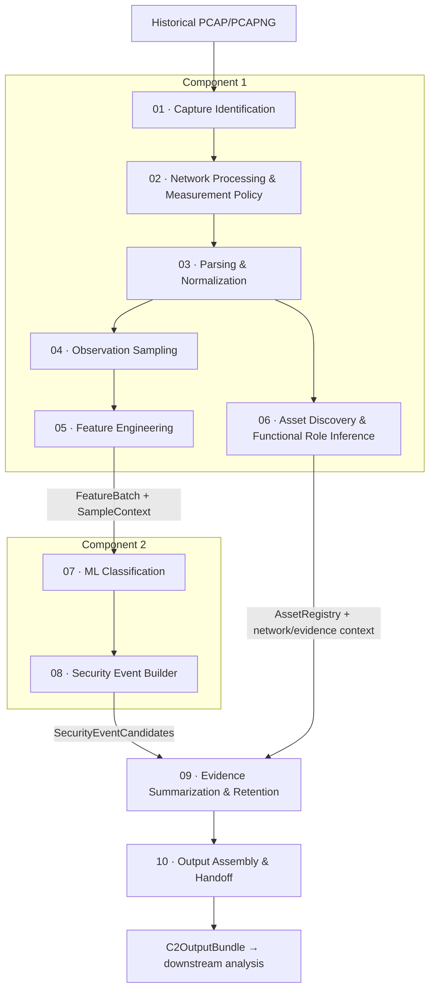

# Network Processing Design — Component 1

## 1. Introduction and Design Objectives

Component 1 transforms one historical PCAP/PCAPNG capture into numerical observations suitable for classification while preserving the network context needed to interpret the result. Packet captures contain protocol headers, payload fragments, packet ordering and capture metadata. These elements cannot be supplied directly as a consistent numerical matrix: individual communications differ in length, protocol and completeness, and a network activity may span many connections.

The design therefore maintains several related representations. **Raw network observations** are the packets available in the capture. **Structured records** describe connections, protocol interactions and packet measurements. **ObservationSamples** combine actual observations for a directed endpoint pair, protocol and time bin. A **FeatureBatch** contains the numerical representation of eligible samples together with explicit sample identities. **SampleContext** preserves their endpoints, times, services, memberships and quality information. **Evidence** consists of the observations or retained supporting measurements that justify a displayed statement. A feature value can help classification without being an additive traffic measurement or a sufficient explanation of an event.

This separation serves two requirements. Component 2 needs a fixed numerical input with identical feature definitions during model development and inference. Downstream analysis needs time, direction, assets and inspectable support. Removing that context from the numerical matrix prevents direct identity shortcuts; retaining it separately prevents the classification result from becoming an unexplained label.

The complete processing flow uses the following stage names and ownership:

| Stage | Name | Responsibility |
| --- | --- | --- |
| 01 | Capture Identification | Component 1 |
| 02 | Network Processing & Measurement Policy | Component 1 |
| 03 | Parsing & Normalization | Component 1 |
| 04 | Observation Sampling | Component 1 |
| 05 | Feature Engineering | Component 1 |
| 06 | Asset Discovery & Functional Role Inference | Component 1 |
| 07 | ML Classification | Component 2 |
| 08 | Security Event Builder | Component 2 |
| 09 | Evidence Summarization & Retention | Shared integration |
| 10 | Output Assembly & Handoff | Shared integration |



Stage numbers identify responsibilities rather than imposing a dependency between the two Component 1 paths. Stage 06 consumes network observations independently of classification and can be scheduled separately from Stages 04–05. Assets remain relevant when their traffic is benign, uncertain or not classified. The diagram does not require concurrent threads.

## 2. Stage 01: Capture Identification

### 2.1 File Validation

A filename is a user-facing description, not a reliable format or identity test. File Validation opens the supplied path read-only, inspects its binary signature and traverses the supported capture records. The implemented reader accepts little- and big-endian PCAP with microsecond or nanosecond timestamp encodings. For PCAPNG, it interprets section byte order, interface timestamp resolution and offset, and enhanced packet blocks.

The reader checks record/block lengths, available bytes and PCAPNG trailing block-length agreement. It rejects unsupported signatures, malformed headers, incomplete records and invalid interface references. Obsolete or timestamp-less PCAPNG packet-block forms are not silently interpreted as enhanced packet blocks. Timestamp resolutions finer than one nanosecond are rejected by this reader. These checks establish the supported container representation; they do not prove that every link-layer format or network protocol is supported by subsequent analysis.

A frame whose captured length is shorter than its recorded original length is counted in `truncated_frames`. Such truncation can preserve a structurally readable capture while limiting payload visibility. It is recorded as a limitation rather than automatically equated with a malformed container or a successful complete observation of the original traffic. Likewise, reversed timestamp order is recorded without shifting packet times.

### 2.2 Capture Identification

Capture Identification computes SHA-256 over the complete file contents and records frame-level time information. A byte-identical file has the same content identity even if its path or filename changes. This makes comparisons between repeated processing runs more defensible than filename matching. It does not, by itself, authenticate the person or system that created the capture.

| Metadata field | Actual representation | Meaning and use |
| --- | --- | --- |
| `path` | String | Resolved source path used for read-only processing. |
| `sha256` | 64-character hexadecimal string | Complete-file content identifier; used as the runtime `capture_key`. |
| `format` | `PCAP` or `PCAPNG` | Format established from the supported binary signature and record structure. |
| `bytes` | Integer | Source file size. |
| `packets` | Integer | Number of supported packet records/frames traversed, including non-IP frames. |
| `min_ns` | Integer or null | Earliest frame timestamp represented in integer nanoseconds; null if no timestamped packets exist. |
| `max_ns` | Integer or null | Latest corresponding frame timestamp. |
| `timestamp_resolutions` | Sorted list of integers | Observed clock tick rates per second, such as 1,000,000 or 1,000,000,000. |
| `truncated_frames` | Integer | Frames with captured length smaller than recorded original length. |
| `file_order_inversions` | Integer | Adjacent timestamp decreases in file order. |

PCAPNG interface ticks are converted to integer-nanosecond bounds using the interface resolution and offset. The source timestamps remain distinct from the clock representation subsequently supplied to Zeek. Representing a bound in nanoseconds does not recover precision absent from the original encoding.

Three identities have different purposes. `capture_key` identifies file content; `analysis_id` identifies an analysis scope; `run_id` distinguishes processing executions. Repeating the same capture can preserve capture-derived sample identities while producing different Zeek UIDs and run-scoped references. Content identification permits recognition of duplicates, but no automatic reuse or deduplication of whole analyses is assumed.

The source size, modification time and SHA-256 are checked around processing. Generated files are written to a separate initially empty output directory. The original capture is not edited or deleted by network processing.

## 3. Stage 02: Network Processing & Measurement Policy

### 3.1 Zeek Processing

Zeek Processing provides connection orientation, transport information, protocol identification and structured logs from historical traffic. A connection record is useful for identifying a communication, but its lifetime summary is not a measurement of each time interval through which it passes. The design therefore combines ordinary connection/protocol logging with a custom measurement stream tied to actual packet callbacks.

The demonstrated environment uses Zeek 8.0.10 offline. The processing configuration writes ASCII tab-separated logs with metadata headers, disables log rotation and records loaded scripts. It supplies no deployment-specific local network ranges and does not classify private address space automatically as local. Consequently, locality fields are not used to infer asset ownership or attack direction.

Execution uses a controlled environment, UTC, fixed script search paths and pinned base/measurement policy contents. The configured limits are 6 GiB address space, 900 CPU seconds, 1,080 wall seconds and 512 MiB per output file. These are bounded execution settings, not measured resource requirements or evidence of performance compliance. Version and policy identities are retained with each execution. Recording a version does not establish compatibility with every other Zeek version.

The offline command uses `-C`, so checksum validation is bypassed for parsing consistency. Successful processing must not be described as verification of packet checksums. The configuration also uses fake DNS resolution for Zeek's own resolver; it does not generate replacement DNS traffic in the capture.

### 3.2 Zeek log inventory

The following inventory is based on actual generated log headers and execution outputs. The core streams support the main processing path. Optional protocol streams depend on traffic and analyzer visibility; their presence is not guaranteed for every capture.

| Zeek log | Generated by | Main purpose | Important fields | Availability |
| --- | --- | --- | --- | --- |
| `conn.log` | Zeek connection analysis | Connection identity, orientation, lifetime context and quality | `uid`, endpoint tuple, `proto`, `service`, `history`, `missed_bytes` | Core connection context; required for the defined connection-supported role assessments. |
| `observation_bins.log` | Custom Packet-Time Measurement policy | Compact per-UID/per-bin measurements | `bucket`, `first`, `last`, directional counters, `new_starts`, `carry_in` | Core custom measurement stream. |
| `observation_audit.log` | Custom Measurement Audit policy | Final callback/coverage reconciliation | `callbacks`, `no_ip`, `direction_unknown`, `remaining_bins` | Required final measurement audit stream. |
| `dns.log` | Zeek DNS analyzer | DNS transaction evidence | `trans_id`, `query`, `qtype`, `rcode`, `rtt` | Optional; present in the complete SMB capture and other inspected logs. |
| `http.log` | Zeek HTTP analyzer | Request/response transaction evidence | `trans_depth`, `method`, `status_code`, `info_code` | Optional; observed in other generated captures, absent from the complete SMB result. |
| `ssh.log` | Zeek SSH analyzer | SSH endpoint/protocol evidence | `client`, `server`, connection tuple | Optional; observed in other generated captures, absent from the complete SMB result. |
| `ssl.log` | Zeek SSL/TLS analyzer | Encrypted-session context | `version`, `cipher`, `server_name`, `established` | Optional; observed in inspected user traffic, not required by the numerical features or four service-role rules. |
| `weird.log` | Zeek anomaly framework | Protocol/connection diagnostics | `name`, `addl`, optional connection identity | Conditional diagnostic output; not an attack-label stream. |
| `loaded_scripts.log` | Loaded-script logging policy | Processing provenance | `name` | Diagnostic output enabled by the base configuration. |
| `packet_filter.log` | Zeek packet-filter framework | Capture-filter activation diagnostics | `filter`, `success`, `failure_reason` | Processing diagnostic output. |

SMB role evidence in this design comes from confirmed service context, connection orientation and bidirectional application-data support. No always-available SMB authentication-message log is assumed. TLS service detection is not automatically converted into HTTP evidence.

### 3.3 Record schemas and field use

Types below are the actual Zeek logged types. The Python reader initially preserves textual values and converts fields where they are consumed. An optional field can be unset even though its column exists. The tables distinguish numerical measurement inputs, role evidence and metadata that is merely available in the observed layout.

#### Connection records

The observed `conn.log` layout has 22 columns. Its packet and byte counters describe the connection-level record, not an individual observation bin.

| Field | Type | Meaning | How Component 1 uses it |
| --- | --- | --- | --- |
| `ts` | `time` | Connection first-packet time. | Connection context; not a substitute for every packet's clock. |
| `uid` | `string` | Connection identifier. | Run-scoped association with bins and protocol records. |
| `id.orig_h` | `addr` | Originator address. | Directed identity and tuple verification. |
| `id.orig_p` | `port` | Originator port or ICMP type context. | Tuple matching; no raw-port ML feature. |
| `id.resp_h` | `addr` | Responder address. | Directed identity and tuple verification. |
| `id.resp_p` | `port` | Responder port or ICMP code context. | Service/tuple qualifiers where applicable. |
| `proto` | `enum` | Transport token. | Transport matching and supported-protocol assessment. |
| `service` | `string` | Service-identification tokens, possibly including removed-service markers. | Only positive consistent tokens support roles; removed tokens are not service proof. |
| `duration` | `interval` | Connection duration. | Lifetime context; not used to distribute packets into bins. |
| `orig_bytes` | `count` | Originator payload-byte estimate. | Positive application-data support in role rules. |
| `resp_bytes` | `count` | Responder payload-byte estimate. | Corresponding response support in role rules. |
| `conn_state` | `string` | Connection state summary. | One part of conservative TCP orientation checks. |
| `local_orig` | `bool` | Optional originator locality. | Preserved context; no configured ownership inference. |
| `local_resp` | `bool` | Optional responder locality. | Same limitation. |
| `missed_bytes` | `count` | Reported missed stream bytes. | Must be present and zero for positive functional attribution. |
| `history` | `string` | Direction-sensitive connection history. | Handshake/data support and quality exclusions. |
| `orig_pkts` | `count` | Connection-level originator packets. | Lifetime comparison/context, not bin input. |
| `orig_ip_bytes` | `count` | Connection-level originator IP bytes. | Lifetime comparison/context, kept distinct from custom-bin bytes. |
| `resp_pkts` | `count` | Connection-level responder packets. | Lifetime comparison/context. |
| `resp_ip_bytes` | `count` | Connection-level responder IP bytes. | Lifetime comparison/context. |
| `tunnel_parents` | `set[string]` | Parent tunnel identifiers. | Available context; not a numerical feature or identity claim. |
| `ip_proto` | `count` | Numeric IP protocol identifier. | Available context; the transport token drives the fixed protocol indicators. |

Connection payload-byte estimates can be imperfect, particularly when inferred from TCP sequence numbers. Duration can omit trailing non-productive TCP packets. Neither therefore establishes the exact last packet time or an application outcome. The field meanings follow the [Zeek connection specification](https://docs.zeek.org/en/v8.0.10/scripts/base/protocols/conn/main.zeek.html), while the separate uses above are specific to Component 1.

#### UID/bin measurement records

The custom `observation_bins.log` layout has 19 columns. A populated row represents one UID in one absolute bin.

| Field | Type | Meaning | How Component 1 uses it |
| --- | --- | --- | --- |
| `uid` | `string` | Owning connection identifier. | Membership, deduplication checks and lineage. |
| `id.orig_h` | `addr` | Final originator address. | Directed sample key and asset association. |
| `id.orig_p` | `port` | Final originator port/type context. | Tuple matching and role qualifiers. |
| `id.resp_h` | `addr` | Final responder address. | Directed sample key and asset association. |
| `id.resp_p` | `port` | Final responder port/code context. | Distinct new destination ports for TCP/UDP. |
| `proto` | `enum` | Transport derived from the typed responder port. | Protocol key and indicators. |
| `bucket` | `count` | Absolute bin start in epoch seconds. | Membership and nominal interval. |
| `first` | `string` | Earliest observed packet clock in this cell, printed to nine decimals. | Actual observation start and span. |
| `last` | `string` | Latest corresponding packet clock. | Actual observation end and span. |
| `connection_start` | `string` | Zeek connection start, printed to nine decimals. | Start/carry-in interpretation and provenance. |
| `orig_packets` | `count` | Originator packet observations in this cell. | Raw directional packet measurement. |
| `resp_packets` | `count` | Responder packet observations in this cell. | Raw directional packet measurement. |
| `orig_ip_bytes` | `count` | Originator IP-header-reported bytes in this cell. | Raw directional byte measurement. |
| `resp_ip_bytes` | `count` | Responder counterpart. | Raw directional byte measurement. |
| `new_starts` | `count` | 1 when this bin equals the connection-start bin, otherwise 0. | Connection-start aggregation. |
| `carry_in` | `bool` | True when this bin is later than the connection-start bin. | Carry-in fraction. |
| `services` | `set[string]` | Service context associated with the final connection record. | Context and role evidence, preserving original tokens. |
| `age_at_first` | `interval` | First cell observation minus connection start. | Input to the maximum observed UID-age measurement. |
| `flips` | `count` | UID-level orientation-flip count. | Functional-role abstention when orientation is ambiguous. |

`services` and `flips` are connection-associated information emitted with the cell. They do not identify the instant a service was first recognized or the number of flips occurring specifically inside that bin. Final service context can be associated retrospectively with earlier observations.

#### Final audit record

| Field | Type | Meaning | How Component 1 uses it |
| --- | --- | --- | --- |
| `callbacks` | `count` | Packet callbacks received by the policy. | Reconciled against summed emitted packet counters. |
| `no_ip` | `count` | Callbacks without a usable IP header. | Must be zero for resolved measurement admission. |
| `direction_unknown` | `count` | Callbacks whose direction cannot be assigned by the policy. | Must be zero for resolved measurement admission. |
| `remaining_bins` | `count` | Measurement cells still present at final audit. | Must be zero to exclude unflushed cells. |

#### Shared protocol-record prefix

The inspected `dns.log`, `http.log`, `ssh.log` and `ssl.log` layouts begin with these six columns in this order. The remaining columns are listed separately for each log.

| Field | Type | Meaning | How Component 1 uses it |
| --- | --- | --- | --- |
| `ts` | `time` | Protocol-specific record time. | Association context; not a per-direction packet timestamp. |
| `uid` | `string` | Owning connection. | Match within the same run. |
| `id.orig_h` | `addr` | Originator address. | Verify peer and orientation. |
| `id.orig_p` | `port` | Originator port. | Verify the original tuple. |
| `id.resp_h` | `addr` | Responder address. | Verify peer and orientation. |
| `id.resp_p` | `port` | Responder port. | Verify service scope without treating the number as role proof. |

#### DNS records

The 24-column DNS layout appends the following 18 fields. `ts` identifies the earliest observed DNS message time for the associated protocol record. DNS can log incomplete transactions; the role rule requires more than column presence.

| Field | Type | Meaning | How Component 1 uses it |
| --- | --- | --- | --- |
| `proto` | `enum` | DNS transport. | Restricts the defined rule to conventional UDP DNS. |
| `trans_id` | `count` | Transaction identifier. | Transaction matching and valid-range check. |
| `rtt` | `interval` | Query-to-answer-start delay. | Requires a present, finite, nonnegative value. |
| `query` | `string` | Queried name. | Required transaction evidence; not an independently discovered asset. |
| `qclass` | `count` | Query class code. | Available context, not a role condition. |
| `qclass_name` | `string` | Query class name. | Same. |
| `qtype` | `count` | Query type code. | Required valid transaction field. |
| `qtype_name` | `string` | Query type name. | Available context. |
| `rcode` | `count` | Response code. | Required response evidence; an error can still support a server-like role. |
| `rcode_name` | `string` | Response code name. | Context, not an attack label. |
| `AA` | `bool` | Authoritative-answer flag. | Available context. |
| `TC` | `bool` | DNS-message truncation flag. | Protocol context, distinct from capture-frame truncation. |
| `RD` | `bool` | Recursion requested. | Available context. |
| `RA` | `bool` | Recursion available. | Available context. |
| `Z` | `count` | DNS reserved flag bits. | Available context. |
| `answers` | `vector[string]` | Answer descriptions. | Not a standalone response or asset-identity proof. |
| `TTLs` | `vector[interval]` | Answer caching intervals. | Available context, not a role condition. |
| `rejected` | `bool` | Query rejection indicator. | Protocol context; no successful-resolution claim. |

Internal analyzer fields such as `saw_query` and `saw_reply` are not columns in the inspected output and are not assumed by the rules. The logged layout and optional semantics correspond to the [DNS record definition](https://github.com/zeek/zeek/blob/v8.0.10/scripts/base/protocols/dns/main.zeek).

#### HTTP records

The 30-column HTTP layout appends these 24 fields. A row associates request/response metadata; `ts` refers to the request time. Only the transaction identity, request method and response-code evidence are used by the defined HTTP role rules.

| Field | Type | Meaning | How Component 1 uses it |
| --- | --- | --- | --- |
| `trans_depth` | `count` | Transaction/pipeline depth. | Transaction identity within a UID. |
| `method` | `string` | Request method. | Alphabetic method plus originator support can establish client-like behavior. |
| `host` | `string` | Host header. | Not used for device identity or roles. |
| `uri` | `string` | Request URI. | Not needed by these rules or retained role support. |
| `referrer` | `string` | Referrer header. | Not used. |
| `version` | `string` | Logged HTTP version. | Context, not a role condition. |
| `user_agent` | `string` | User-Agent header. | Not used to infer a physical device or operating system. |
| `origin` | `string` | Origin header. | Not used. |
| `request_body_len` | `count` | Request content length measured by the analyzer. | Not needed by these role rules. |
| `response_body_len` | `count` | Response counterpart. | Zero does not invalidate a supported HEAD response. |
| `status_code` | `count` | Response status code. | Response evidence when valid. |
| `status_msg` | `string` | Status text. | Not needed. |
| `info_code` | `count` | Informational response code. | Can support a response when valid. |
| `info_msg` | `string` | Informational text. | Not needed. |
| `tags` | `set[enum]` | Analyzer tags. | Not used as supervised labels or compromise proof. |
| `username` | `string` | Optional authentication username. | Excluded from retained role evidence. |
| `password` | `string` | Optional authentication password field. | Excluded; column presence does not mean a password value was captured. |
| `proxied` | `set[string]` | Proxy-related header information. | Not used. |
| `orig_fuids` | `vector[string]` | Originator file identifiers. | Not used by the four service-role rules. |
| `orig_filenames` | `vector[string]` | Originator file names. | Not needed or retained for roles. |
| `orig_mime_types` | `vector[string]` | Originator MIME types. | Not used. |
| `resp_fuids` | `vector[string]` | Responder file identifiers. | Not used. |
| `resp_filenames` | `vector[string]` | Responder file names. | Not needed or retained for roles. |
| `resp_mime_types` | `vector[string]` | Responder MIME types. | Not used. |

These meanings are consistent with the [HTTP record definition](https://docs.zeek.org/en/v8.0.10/scripts/base/protocols/http/main.zeek.html). The numerical feature vector does not include HTTP header strings, bodies or credentials.

#### SSH records

The 18-column SSH layout appends these 12 fields. `ts` describes the beginning of the SSH communication. Endpoint banners support limited functional interpretation without treating encrypted-session metadata as independent ground truth.

| Field | Type | Meaning | How Component 1 uses it |
| --- | --- | --- | --- |
| `version` | `count` | SSH major version. | Available context. |
| `auth_success` | `bool` | Optional analyzer authentication result. | Not used for functional roles or a compromise claim. |
| `auth_attempts` | `count` | Analyzer-reported authentication observations. | Not used; zero or absence is not a verified count of all real attempts. |
| `direction` | `enum` | Locality-relative direction. | Not used for client/server or attacker/victim attribution. |
| `client` | `string` | Client identification banner. | Requires a present `SSH-` prefix and directional support. |
| `server` | `string` | Server identification banner. | Corresponding server-like support. |
| `cipher_alg` | `string` | Cipher algorithm. | Available context, not a feature. |
| `mac_alg` | `string` | Integrity algorithm. | Not used by the role rule. |
| `compression_alg` | `string` | Compression algorithm. | Available context. |
| `kex_alg` | `string` | Key-exchange algorithm. | Not used by the role rule. |
| `host_key_alg` | `string` | Host-key algorithm. | Not used for asset identity. |
| `host_key` | `string` | Logged host-key fingerprint. | Not used for identity resolution. |

The [SSH specification](https://docs.zeek.org/en/v8.0.10/scripts/base/protocols/ssh/main.zeek.html) describes analyzer-dependent authentication information. The role design uses banner evidence rather than assuming those fields establish a successful login.

#### TLS and diagnostic records

The 18-column `ssl.log` layout uses the shared six-field prefix and the following suffix. It provides optional context; it supplies none of the 23 numerical inputs or four defined positive service-role rules.

| Field | Type | Meaning | How Component 1 uses it |
| --- | --- | --- | --- |
| `version` | `string` | TLS version. | Optional context only. |
| `cipher` | `string` | Cipher selection. | Optional context only. |
| `curve` | `string` | Cryptographic curve. | Optional context only. |
| `server_name` | `string` | Server-name indication. | Not an independently observed IP asset. |
| `resumed` | `bool` | Session resumption indicator. | No role or outcome inference. |
| `last_alert` | `string` | Last recorded TLS alert. | Diagnostic context. |
| `next_protocol` | `string` | Application-protocol negotiation context. | No automatic HTTP interpretation. |
| `established` | `bool` | Encryption establishment indicator. | Does not establish application authentication. |
| `ssl_history` | `string` | TLS-specific history. | Not substituted for connection history. |
| `cert_chain_fps` | `vector[string]` | Server certificate fingerprints. | Not used by this asset identity policy. |
| `client_cert_chain_fps` | `vector[string]` | Client certificate fingerprints. | Same. |
| `sni_matches_cert` | `bool` | Optional server-name/certificate match result. | Context, not compromise or physical identity evidence. |

The inventory follows the [TLS logging definition](https://docs.zeek.org/en/v8.0.10/scripts/base/protocols/ssl/main.zeek.html); encryption can prevent the application evidence required by a service rule from being observed.

`weird.log` has the shared timestamp/UID/tuple column layout. Its UID and tuple can be unset when an anomaly cannot be attached to a connection. The remaining fields are:

| Field | Type | Meaning | How Component 1 uses it |
| --- | --- | --- | --- |
| `name` | `string` | Anomaly name. | Diagnostic explanation, not an attack class. |
| `addl` | `string` | Additional detail. | Context when available. |
| `notice` | `bool` | Notice-generation indication. | Diagnostic handling only. |
| `peer` | `string` | Reporting Zeek peer. | Processing context, not an endpoint role. |
| `source` | `string` | Optional anomaly source description. | Diagnostic provenance. |

An anomaly can reflect malformed traffic or incomplete interpretation; it is not a standalone maliciousness conclusion. This distinction follows the [anomaly framework](https://docs.zeek.org/en/v8.0.10/scripts/base/frameworks/notice/weird.zeek.html).

`loaded_scripts.log` has one field:

| Field | Type | Meaning | How Component 1 uses it |
| --- | --- | --- | --- |
| `name` | `string` | Loaded script path. | Processing provenance, not a network endpoint or feature. |

`packet_filter.log` has these six fields:

| Field | Type | Meaning | How Component 1 uses it |
| --- | --- | --- | --- |
| `ts` | `time` | Filter-activation time. | Processing provenance; not substituted for capture activity time. |
| `node` | `string` | Reporting process/node. | Execution context. |
| `filter` | `string` | Installed filter expression. | Documents traffic-selection configuration. |
| `init` | `bool` | Initialization-related activation. | Diagnostic context. |
| `success` | `bool` | Activation outcome. | Reveals filter setup problems. |
| `failure_reason` | `string` | Optional failure description. | Explains a failed activation. |

The [packet-filter framework](https://docs.zeek.org/en/v8.0.10/scripts/base/frameworks/packet-filter/main.zeek.html) concerns processing configuration. Its successful initialization is not proof of complete packet interpretation.

### 3.4 Packet-Time Measurement

Packet-Time Measurement attaches measurements to the Zeek connection supplied to each packet callback. Let a packet have connection UID $u$, observation time $t$, and bin start $b=10\lfloor t/10\rfloor$. A cell is identified by $(u,b)$. It is created only when an admissible packet is actually observed.

Each cell stores the endpoint orientation available when it is created, the minimum and maximum packet clocks, and four directional counters. The current packet must match the connection's two endpoint addresses in one direction or the other. Same-address traffic and unmatched address pairs increment `direction_unknown` instead of receiving a guessed direction.

Let $\ell(p)$ be the IP-byte contribution of observed packet $p$. The implemented length rule is:

$$
\ell(p)=
\begin{cases}
p.\mathrm{ip.len}, & \text{IPv4},\\
p.\mathrm{ip6.len}+40, & \text{IPv6}.
\end{cases}
$$

The IPv6 length adds the fixed header to the logged payload-length value. These are IP-header-reported lengths, not Ethernet wire bytes, disk-record sizes or application payload bytes. For direction $d$, the cell's packet counter increases by one and its IP-byte counter increases by $\ell(p)$. The earliest and latest actual clocks are updated independently of file order.

The policy counts connection-orientation changes. When the connection is removed, cell counters are reconciled to its final originator/responder tuple: if the stored originator address differs from the final originator address, both packet and byte directions are swapped. The output tuple and transport are the final connection tuple and the transport associated with its typed responder port. Thus a reconciled measurement can remain usable for traffic counting while functional attribution abstains because the connection experienced a flip.

Let $t_0(u)$ denote Zeek's connection start and $b_0(u)=10\lfloor t_0(u)/10\rfloor$. Let $\mathbf{1}[\cdot]$ denote one when the condition holds and zero otherwise. For an emitted cell:

$$
\mathrm{new\_starts}(u,b)=\mathbf{1}[b=b_0(u)],\qquad
\mathrm{carry\_in}(u,b)=\mathbf{1}[b>b_0(u)].
$$

The reported `age_at_first` is the cell's first observation minus $t_0(u)$. A new start means a Zeek connection-start membership, not proof of a completed TCP handshake. Under unusual timestamp ordering, a bin earlier than $b_0(u)$ can have neither flag; carry-in must not be calculated as one minus the start flag.

One row is written for each populated UID/bin cell at connection removal. Cells are then deleted. The policy does not write a row for every packet or synthesize quiet bins. A long-lived connection can therefore contribute to several samples through disjoint packet contributions. Active cells remain in memory until removal, so memory depends on the active connections and their observed bins rather than being constant for every capture.

Lifetime totals cannot provide this attribution. Assigning all connection packets to its start bin places later packets at an earlier time. Copying totals into every crossed bin counts packets repeatedly. A bounded measurement comparison found 17 packet-observation groups where connection-start membership produced 11 in a Slowloris interval. One tracked connection contributed 45 packets across 12 observed bins; three quiet internal bins were absent. This supports observation-time membership for that measured case, not an experimentally demonstrated universal choice of window length.

### 3.5 Measurement Audit

Measurement Audit expects one final audit record and unique UID/bin records. It requires zero unusable-IP callbacks, unresolved directions and remaining cells, and checks:

$$
\mathrm{callbacks}
=\sum_{(u,b)}\left(\mathrm{orig\_packets}_{u,b}+\mathrm{resp\_packets}_{u,b}\right).
$$

A nonzero process exit, timeout or changed source prevents a complete execution result. Missing/ambiguous final audit data or malformed records produce an explicit processing error. Failed counter/direction reconciliation prevents measurement admission even when the operating-system process exited successfully.

The audit concerns callbacks received by this measurement policy. It does not independently prove that every original frame triggered a callback, that no packets were lost before capture, or that every application message was decoded correctly. Independent frame accounting is needed when claiming agreement with captured IP frames. The real-capture demonstration below performs that additional reconciliation. Non-IP frames are not automatically missing IP observations.

## 4. Stage 03: Parsing & Normalization

### 4.1 Representing different record types

A connection record, a DNS transaction and a UID/bin measurement describe different units. A connection can have many transactions and many observation bins; treating them as interchangeable rows either duplicates measurements or discards detail. Parsing & Normalization therefore produces typed views of these records with shared identity and provenance fields. It does not merge every log into a single flat table or equate protocol-message counts with connection counts.

### 4.2 Log Parsing

Log Parsing reads the configured tab-separated representation using UTF-8 with optional byte-order-mark handling. It obtains the field order from `#fields`, ignores comment/header lines and blank lines, and maps each data row to its named fields. A row before the field header or with a different number of values is rejected. Physical source line numbers include header lines, so a reference can identify the original row without relying on its position in another file.

The reader is deliberately narrower than a universal Zeek importer. It does not automatically convert every column from `#types`, decode every possible Zeek escape sequence or accept a JSON logger layout. The inspected `#types` headers establish the documented schemas; consuming code performs the conversions needed for measurements and role rules. Changing the logger representation would require a corresponding parser change.

### 4.3 Field Normalization

Field Normalization converts values according to their use while retaining the original record for traceability.

| Value category | Applied interpretation | Boundary or limitation |
| --- | --- | --- |
| Capture clocks | Integer nanoseconds for capture bounds. | Clock resolution is recorded; nanosecond representation is not a claim of nanosecond source accuracy. |
| Observation clocks | `first`, `last` and `connection_start` remain decimal timestamp strings; bin starts are integers. | Span/age feature arithmetic uses floating-point values. Retained evidence can use decimal subtraction without replacing feature arithmetic. |
| IP addresses | Validated as IPv4/IPv6; original window address strings remain available. | Canonical compressed/lowercase address identity is applied in AssetRegistry, not by rewriting all source records. |
| Protocol | Measured `tcp`, `udp` or `icmp` value. | Unsupported values fail sample assessment; the field is not inferred from a destination port. |
| Ports | Original tuple values remain available; supported service rules parse valid integer transport ports. | ICMP type/code context is not a TCP/UDP service port. No port-number feature is passed directly to the model. |
| Counters | Required packet, byte and start fields become integers. | An unset required counter is not converted to zero. Negative or non-finite values are invalid. |
| Booleans | Zeek `T`/`F` where consumed, including `carry_in`. | Unknown/unset values do not establish positive evidence. |
| Services | Comma-separated positive service tokens are collected, excluding empty, unset and empty-set markers. | The original token is retained; role comparisons use case-insensitive service matching. Service detection is not proof of an authentication action. |
| State/history | Original `conn_state` and `history` strings. | Role rules interpret supported values explicitly; a reset is not translated into an authentication-failure label. |
| Missing values | `-` denotes unset; `(empty)` denotes an empty collection in the configured format. | Unset, empty collection, empty text and numerical zero have different meanings. |
| Provenance | Capture/run scope, record kind, source-log digest and physical row location. | A row number locates a record; it is not a cross-log join key. |

The design preserves absent optional protocol evidence. Missing `http.log`, for example, prevents the HTTP-specific role rule from using transaction fields; it does not establish that the capture contained no HTTP-related traffic. A zero-valued measured counter, in contrast, is a supported numerical observation within the admitted measurement scope.

### 4.4 Common network record structure

`NormalizedNetworkRecord` is the logical view used to explain shared network information. It is not a claim that the implementation stores every field in one Python class or database table. Connection rows, UID/bin rows and optional protocol rows remain separate physical records. The mapping below describes the corresponding fields and the typed view consumed by later operations.

| Normalized field | Source log or scope | Original field | Logical type | Meaning |
| --- | --- | --- | --- | --- |
| `analysis_id`, `run_id`, `capture_key` | Processing envelope | `_scope` and capture SHA-256 association | Strings | Analysis, execution and content scope of the record. |
| `record_kind` | Source descriptor | `_ref.kind` | String | Connection, bin or protocol record type. |
| `uid` | Connection/bin/protocol logs | `uid` | String | Connection identifier within the specified run. |
| `orig_h`, `resp_h` | Connection/bin/protocol logs | `id.orig_h`, `id.resp_h` | IP-address strings | Zeek-oriented endpoints. |
| `orig_p`, `resp_p` | Connection/bin/protocol logs | `id.orig_p`, `id.resp_p` | Original strings; validated integers where applicable | Transport ports or protocol-specific tuple values. |
| `proto` | Connection/bin logs; DNS when present | `proto` | String | Transport represented by the record. |
| `service_tokens` | Connection/bin logs | `service`, `services` | Collection of strings | Available confirmed service associations, subject to role-rule checks. |
| `connection_ts` | `conn.log` | `ts` | Time value | Logged connection start context. |
| `connection_duration_s` | `conn.log` | `duration` | Optional nonnegative number | Logged connection duration, distinct from a bin's observation span. |
| `connection_state`, `connection_history` | `conn.log` | `conn_state`, `history` | Optional strings | State and direction/event context used by conservative role rules. |
| `missed_bytes` | `conn.log` | `missed_bytes` | Optional integer | Known content gap indicator for the connection. |
| `connection_orig_payload_bytes`, `connection_resp_payload_bytes` | `conn.log` | `orig_bytes`, `resp_bytes` | Optional integers | Connection-level application-payload byte estimates. |
| `connection_orig_packets`, `connection_resp_packets` | `conn.log` | `orig_pkts`, `resp_pkts` | Optional integers | Connection-level packet totals. |
| `connection_orig_ip_bytes`, `connection_resp_ip_bytes` | `conn.log` | `orig_ip_bytes`, `resp_ip_bytes` | Optional integers | Connection-level IP-byte totals. |
| `bucket` | `observation_bins.log` | `bucket` | Integer seconds | Absolute start of the populated 10-second bin. |
| `observed_start`, `observed_end` | `observation_bins.log` | `first`, `last` | Decimal timestamp strings | Earliest/latest actual observation in that UID/bin. |
| `connection_start` | `observation_bins.log` | `connection_start` | Decimal timestamp string | Measurement-policy connection-start clock. |
| `orig_packets`, `resp_packets` | `observation_bins.log` | `orig_packets`, `resp_packets` | Nonnegative integers | Packets observed in this UID/bin only. |
| `orig_ip_bytes`, `resp_ip_bytes` | `observation_bins.log` | `orig_ip_bytes`, `resp_ip_bytes` | Nonnegative integers | IP bytes measured in this UID/bin only. |
| `new_starts` | `observation_bins.log` | `new_starts` | Integer indicator | Membership in the connection's start bin. |
| `carry_in` | `observation_bins.log` | `carry_in` | Boolean | Contribution to a bin later than the connection's start bin. |
| `age_at_first_s` | `observation_bins.log` | `age_at_first` | Number | First observation minus connection start. |
| `orientation_flips` | `observation_bins.log` | `flips` | Integer | UID-level direction-flip count repeated on its rows. |
| `transaction_context` | Optional protocol log | Fields listed in Section 3.3 | Record-specific values | DNS/HTTP transaction or SSH/TLS connection context; not universal columns. |
| `source_location` | Source descriptor | Log identity/digest and physical line in `_ref` | Structured reference | Location of the source record before temporary cleanup. |
| `evidence_refs` | Scoped lineage metadata | Associated source/evidence references | Collection of references | Links to source records or deliberately retained support. |

Here `connection_orig_packets` is a logical disambiguation of `conn.log`'s `orig_pkts`, not a renamed physical source column. Similarly, `service_tokens` explains the relationship between the singular connection field and the custom bin collection. Fields not supplied by a particular record type remain absent or optional; they are not filled using unrelated rows.

### 4.5 UID Matching

UID Matching associates bins with the connection that produced them using the processing scope and UID. Endpoint addresses, ports and protocol must agree with the supported tuple interpretation. Optional protocol records are associated within that same scope. HTTP transactions additionally use transaction depth; DNS uses its transaction attributes. Several protocol records may legitimately reference one UID.

A UID is not treated as a globally stable identifier across captures or replays. The same capture can receive different UIDs in another Zeek run. A source-record reference therefore carries run scope and source location as well as its UID. Capture-derived sample identity is a separate mechanism described below.

Duplicate `(uid, bucket)` measurement rows are rejected during sample construction because summing them would duplicate packet observations. Asset evidence analysis can deduplicate identical source observations, but conflicting UID/bin or protocol associations are explicitly withheld from role attribution or flagged. Neither operation joins by row number or selects the most convenient conflicting label.

### 4.6 Connection totals versus observation measurements

Consider an illustrative connection with 12 packets: three at times 100.2–109.8 seconds and nine at 110.1–118.4 seconds. Its connection total is 12. The first bin contains three observed packets and the second contains nine. Assigning 12 to the first bin misplaces nine packets; assigning 12 to both bins invents a total of 24. A zero-traffic gap would not create a third measurement row.

The measured multi-bin connection discussed in Section 3.4 demonstrates the same issue in actual traffic. `conn.log` remains useful for lifetime and service context, while `observation_bins.log` supplies time-local measurements. Neither `conn.ts + duration` nor lifetime packet totals replace the observed `first`, `last` and counters of an individual bin.

## 5. Stage 04: Observation Sampling

### 5.1 Choosing the unit of analysis

Individual packets provide timing detail but are too fine-grained to represent repeated contacts or service activity directly. A per-packet representation would also multiply the downstream sample volume. Individual connections provide a useful baseline, yet repeated activity may be fragmented into many similar short rows, while one persistent connection can span several observation periods.

Connection-start grouping combines nearby starts but loses ongoing traffic after the start bin. The measured Slowloris comparison in Section 3.4 establishes that this limitation occurs in the inspected traffic. Directed observation-time grouping addresses it by combining actual packet contributions in fixed intervals. Its direction preserves which Zeek endpoint initiated the interaction and which endpoint responded; it does not assign attacker or victim identity. No experiment comparing every possible non-directed key or window length is implied by this rationale.

### 5.2 Absolute 10-second windows

Let $t$ be a packet observation time in seconds and $b(t)$ its bin start. The bin calculation and membership are:

$$
b(t)=10\left\lfloor\frac{t}{10}\right\rfloor,
\qquad W(t)=[b(t),b(t)+10).
$$

The half-open interval gives every timestamp exactly one bin. For example, 109.999 seconds belongs to `[100,110)`, while 110.000 belongs to `[110,120)`. Absolute boundaries are independent of when processing starts or where an activity annotation begins. This makes construction reproducible and avoids using ground truth to choose the sample boundaries.

The 10-second width is the fixed system representation. It is not presented as an experimentally optimal duration for every activity. A sample's nominal interval covers ten seconds; its actual observations can occupy a much shorter span.

### 5.3 10s Sample Grouping

The exact directed grouping key is:

```text
(capture_key, orig_h, resp_h, proto, bucket)
```

`capture_key` prevents mixing observations from different source files. The two addresses retain direction and target membership. `proto` separates transport contexts. `bucket` supplies the absolute time boundary. Ports and labels are absent from the key: multiple destination ports can therefore be represented in one probing sample, and original annotations cannot determine membership.

Each populated UID/bin contributes to one such group. One UID may contribute to several time bins, but its packets are counted only in their actual bins. An empty or quiet interval does not produce a fabricated sample. The observed sample start is the minimum contributing `first`; its observed end is the maximum contributing `last`.

The deterministic sample identifier is `sample-` followed by the first 24 hexadecimal characters of SHA-256 over a compact UTF-8 JSON array containing the sample-version literal, capture content key, directed addresses, protocol and integer bucket. The implemented sample-version literal is `obs10-full-v1`. JSON separators are compact, Unicode is retained and non-finite values are disallowed. This identity excludes UIDs, labels and file paths. It can remain stable across replays while its run-scoped evidence references change.

### 5.4 Raw Measurement Aggregation

For sample $s$, let $U_s$ be its set of contributing UIDs. Each UID has one measurement row in this bin. Let $n_s=\mathrm{card}(U_s)$. For row $u$, define $a_u$ as `new_starts`, $c_u$ as the `carry_in` indicator, $p^o_u,p^r_u$ as originator/responder packet counts, $q^o_u,q^r_u$ as IP-byte counts, $f_u,l_u$ as first/last observation times, $g_u$ as `age_at_first`, and $d_u$ as the responder-port token. Let $D_s$ be the set of $d_u$ values for rows with $a_u>0$, when the protocol is TCP or UDP. Floating-point conversion of logged clock/interval values is denoted by $\mathrm{float}$.

| Measurement | Definition / formula | Purpose |
| --- | --- | --- |
| `new_connection_starts` | $\sum_{u\in U_s}a_u$ | Number of contributing connection-start memberships. |
| `distinct_new_destination_ports` | $\mathrm{card}(D_s)$ for TCP/UDP; null for ICMP. | Diversity of newly contacted service ports, excluding carry-in-only contacts. |
| `orig_packets` | $\sum_{u\in U_s}p^o_u$ | Actual originator packet observations in this sample. |
| `resp_packets` | $\sum_{u\in U_s}p^r_u$ | Actual responder packet observations. |
| `orig_ip_bytes` | $\sum_{u\in U_s}q^o_u$ | Observed originator IP bytes. |
| `resp_ip_bytes` | $\sum_{u\in U_s}q^r_u$ | Observed responder IP bytes. |
| `contributing_uids` | $n_s$ | Distinct observed connections, including carry-in participation. |
| `carry_in_fraction` | $\sum_{u\in U_s}c_u/n_s$ | Fraction of contributing UIDs whose start bin precedes this bin. |
| `max_observed_uid_age_s` | $\max(\{0\}\cup\{\mathrm{float}(g_u):u\in U_s\})$ | Largest observed UID age, with the implemented zero floor. |
| `mean_uid_observation_span_s` | $\sum_{u\in U_s}(\mathrm{float}(l_u)-\mathrm{float}(f_u))/n_s$ | Mean span of observed contributions per UID, not mean connection lifetime. |
| `sample_observation_span_s` | $\mathrm{float}(\max_u l_u)-\mathrm{float}(\min_u f_u)$ | Span from earliest to latest sample observation. |

All admitted samples have at least one UID, so these means do not divide by zero. Destination-port tokens come from the original measurement tuple; this statistic is not a guess based on packet sizes. ICMP's null destination-port diversity is preserved in raw measurements and mapped to zero only for the applicable numerical feature calculation.

The age zero floor does not repair packet clocks or rewrite a negative source interval. Raw timestamp/age information remains available for auditing. Likewise, the span calculations use the implemented floating-point subtraction, which can differ slightly from decimal subtraction of the displayed nanosecond strings. The numerical implementation is retained consistently during both training and inference.

These eleven values are pair-local measurements. Source-wide effective features are stored separately because they can repeat context across several samples and cannot be summed as captured traffic.

### 5.5 Sample Eligibility Assessment

Sample Eligibility Assessment separates measurement validity, contextual usefulness and admission to inference. It requires a nonempty unique sample ID; valid same-version IP endpoints; a supported protocol; an integer bucket aligned to ten seconds; and finite observed times inside the half-open bin in nondecreasing order. Required measurements must be finite and nonnegative. Count fields must be integer-valued, except for the explicitly absent ICMP destination-port statistic.

Further consistency checks require at least one contributing UID and one observed packet, starts no greater than contributing UIDs, carry-in fraction in `[0,1]`, and both mean UID span and sample span below ten seconds. The processing flags must establish a complete run and resolved measurement direction. Bin completeness must be a known Boolean rather than an assumed value.

Let $T_{\min}$ and $T_{\max}$ be the capture-wide frame timestamp bounds in nanoseconds, and let $b$ be the integer bin start in seconds. The implemented full-bin condition is:

$$
10^9b\ge T_{\min}
\quad\land\quad
10^9(b+10)\le T_{\max}.
$$

These bounds use the inspected capture frames, including non-IP frames. They establish whether the capture covers the nominal interval, not whether every instant contains traffic or every packet was captured at the source.

| Assessment outcome | `context_eligible` | `inference_eligible` | Consequence |
| --- | --- | --- | --- |
| Valid measurements, complete processing/direction, full bin | True | True | Supplies context and a model input row. |
| Valid measurements, complete processing/direction, capture-edge partial bin | True | False | Supplies behavioral context only; exclusion reason `PARTIAL_CAPTURE_EDGE_BIN`. |
| Invalid required data, unsupported domain or incomplete processing/direction | False | False | Explicit assessment reason; no numerical inference row. |

Label purity, original subtype, annotation availability and partition identity do not enter runtime eligibility. Training admission additionally requires valid source-qualified supervised truth, but that requirement does not remove valid unlabeled windows from runtime context. A sample excluded from inference is `NOT_ANALYZED`; it is never silently labeled `BENIGN`.

## 6. Stage 05: Feature Engineering

The raw measurements describe one directed pair in one bin. That view can expose many-port contacts against one target, but a horizontal contact pattern can distribute small observations across many targets. Persistence also requires neighboring observations: one short bin cannot distinguish isolated activity from a longer repeated pattern by duration alone. Feature Engineering combines pair-local measurements with source-wide and temporal context while retaining the original pair measurements separately.

This is an explanatory representation, not proof that a particular count identifies malicious intent. Legitimate administration, service discovery and load can produce similar observations. A fixed supervised model interprets the numerical representation; neither contextual rule assigns an attack label on its own.

For the formulas below, the following symbols denote the raw measurements of sample $s$:

| Symbol | Raw measurement |
| --- | --- |
| $N_s$ | `contributing_uids` |
| $S_s$ | `new_connection_starts` |
| $D_s$ | `distinct_new_destination_ports`, with ICMP null mapped to numerical zero |
| $P^o_s,P^r_s$ | `orig_packets`, `resp_packets` |
| $B^o_s,B^r_s$ | `orig_ip_bytes`, `resp_ip_bytes` |
| $C_s$ | `carry_in_fraction` |
| $A_s$ | `max_observed_uid_age_s` |
| $L_s$ | `mean_uid_observation_span_s` |
| $T_s$ | `sample_observation_span_s` |

### 6.1 Source-Wide Sweep Context

Let $Q_s$ contain all context-eligible samples with the same capture, originator, protocol and bucket as $s$, and with zero responder packets. Let $\nu_s=\mathrm{card}(Q_s)$. Because directed keys are unique, this counts unanswered target-pair bins for that source/protocol/bin. Define the activation indicator $\chi_s$ and the four source-wide sums as follows:

$$
\chi_s=\mathbf{1}[P^r_s=0\ \land\ \nu_s\ge5],
$$

$$
\Sigma S_s=\sum_{q\in Q_s}S_q,\qquad
\Sigma D_s=\sum_{q\in Q_s}D_q,\qquad
\Sigma P_s=\sum_{q\in Q_s}P^o_q,\qquad
\Sigma B_s=\sum_{q\in Q_s}B^o_q.
$$

The notation $\mathbf{1}[\cdot]$ denotes one when the stated condition holds and zero otherwise. The numerical threshold five is an implemented contextual heuristic, not a universal intrusion-detection boundary. The implementation does not restrict activation to TCP. Zero responder packets means no responder observation within that sample, not proof that the endpoint never responded elsewhere or that the contact was unauthorized.

For an active sample, define effective UID, start, endpoint-diversity, originator-packet and originator-byte values $E_N,E_S,E_D,E_P,E_B$. Each expression below applies to the current sample $s$:

$$
E_N=\begin{cases}\max(N_s,\Sigma S_s)&\chi_s=1\\N_s&\chi_s=0,\end{cases}
\qquad
E_S=\begin{cases}\max(S_s,\Sigma S_s)&\chi_s=1\\S_s&\chi_s=0,\end{cases}
$$

$$
E_D=\begin{cases}\max(D_s,\Sigma D_s)&\chi_s=1\\D_s&\chi_s=0,\end{cases}
\qquad
E_P=\begin{cases}\max(P^o_s,\Sigma P_s)&\chi_s=1\\P^o_s&\chi_s=0,\end{cases}
$$

$$
E_B=\begin{cases}\max(B^o_s,\Sigma B_s)&\chi_s=1\\B^o_s&\chi_s=0.\end{cases}
$$

Two details are essential for reproducing the implementation. First, `eff_uids` uses the sum of unanswered **connection starts** as its source-wide lower bound; it is not a count of distinct source-wide UIDs. Second, `eff_probed_endpoints` uses the sum of per-target distinct new destination ports. It is neither a global distinct-port union nor simply the number of targets. The feature names identify the existing representation; their precise calculations determine their meaning.

Responder packets/bytes, carry-in fraction, UID age and observation spans remain pair-local. The implementation records the active sweep cohort and its actual target/sample membership for interpretation. It does not replace the raw traffic evidence with effective values. For example, if five unanswered pair samples each contain two originator packets, each can receive a contextual effective count of ten. Summing those five effective values would yield fifty even though only ten packets were measured. This arithmetic illustration explains why retained traffic summaries must use raw contributions.

### 6.2 70s Temporal Context

The system processes a historical capture, so context can include observations after the current bin. Let $b_s$ be its bucket and let the offset set be:

$$
\Delta=\{-30,-20,-10,0,10,20,30\}.
$$

Let $H_s$ contain context-eligible samples for the same capture, directed address pair and protocol whose bucket equals $b_s+\delta$ for an offset $\delta\in\Delta$. Define four pair-local neighborhood aggregates:

$$
H_A=\mathrm{card}(H_s),\qquad
H_S=\sum_{q\in H_s}S_q,\qquad
H_N=\max(\{0\}\cup\{N_q:q\in H_s\}),\qquad
H_P=\sum_{q\in H_s}(P^o_q+P^r_q).
$$

The seven nominal bins span `[bucket − 30, bucket + 40)`, a 70-second interval. `H_A` counts existing observed bins, not seven automatically populated intervals. The calculations use neighbors' raw pair measurements, not their effective feature vectors. The current sample's effective values then provide lower bounds through the `max` operations in features 21–23.

Valid partial-edge bins can contribute context even though they receive no model prediction. Invalid measurements cannot. Context never crosses captures, protocols or reversed endpoint direction. The future offsets make the method an offline representation; the same equations cannot be described as causal real-time detection without changing their availability assumptions.

### 6.3 23-Feature Calculation

The ordered feature specification is `obs23-behavioral-rf-v2`. All entries below are supplied as `float64`, including integer-valued counts and protocol indicators. Feature positions are part of the model interface and must not be rearranged.

| # | Feature name | Exact formula / calculation | Behavioral meaning | Why it is useful |
| --- | --- | --- | --- | --- |
| 1 | `eff_uids` | $E_N$ | Pair UID count with the implemented source-wide start lower bound when active. | Represents concentrated or distributed contact scale. |
| 2 | `eff_new_starts` | $E_S$ | New-start intensity with optional source-wide context. | Separates repeated starts from ongoing participation. |
| 3 | `eff_probed_endpoints` | $E_D$ | New-port diversity, optionally summed across unanswered targets. | Exposes multi-port and distributed contact patterns. |
| 4 | `eff_orig_pkts` | $E_P$ | Originator observation volume with optional sweep context. | Represents traffic intensity without raw endpoint identities. |
| 5 | `pair_resp_pkts` | $P^r_s$ | Pair-local responder packets. | Preserves whether/how much a particular target responded. |
| 6 | `eff_orig_bytes` | $E_B$ | Originator IP-byte volume with optional sweep context. | Distinguishes traffic volume beyond packet counts. |
| 7 | `pair_resp_bytes` | $B^r_s$ | Pair-local responder IP bytes. | Preserves the target's observed traffic contribution. |
| 8 | `carry_in_fraction` | $C_s$ | Fraction of observed UIDs continuing from earlier start bins. | Represents persistence without inventing quiet traffic. |
| 9 | `max_uid_age_s` | $A_s$ | Maximum observed UID age, zero-floored during raw aggregation. | Exposes long-lived participation. |
| 10 | `mean_uid_span_s` | $L_s$ | Average within-bin UID observation span. | Distinguishes brief contacts from observations spread within a bin. |
| 11 | `sample_span_s` | $T_s$ | Earliest-to-latest observed span for the pair/bin. | Represents temporal spread of the group's actual observations. |
| 12 | `is_tcp` | $\mathbf{1}[\mathrm{proto}_s=\text{tcp}]$ | TCP indicator. | Allows transport-specific interpretation of counts. |
| 13 | `is_udp` | $\mathbf{1}[\mathrm{proto}_s=\text{udp}]$ | UDP indicator. | Distinguishes datagram contexts. |
| 14 | `is_icmp` | $\mathbf{1}[\mathrm{proto}_s=\text{icmp}]$ | ICMP indicator. | Prevents interpreting absent transport ports as TCP/UDP activity. |
| 15 | `eff_resp_pkt_share` | $P^r_s/(E_P+P^r_s+1)$ | Smoothed responder packet share using the effective originator count. | Represents directional imbalance; not a pure pair-local ratio when sweep context is active. |
| 16 | `eff_resp_byte_share` | $B^r_s/(E_B+B^r_s+1)$ | Smoothed responder IP-byte share. | Represents directional volume imbalance. |
| 17 | `eff_bytes_per_orig_pkt` | $E_B/(E_P+1)$ | Smoothed IP bytes per effective originator packet. | Provides packet-size context without payload inspection. |
| 18 | `eff_pkts_per_uid` | $(E_P+P^r_s)/\max(E_N,1)$ | Packets relative to the effective UID/start denominator. | Helps distinguish brief contacts from packet-rich activity. |
| 19 | `eff_ports_per_start` | $E_D/\max(E_S,1)$ | Effective new-port diversity per start. | Describes repeated contacts versus diversity of contacted ports. |
| 20 | `eff_active_bins_70s` | $H_A$ | Number of observed pair/protocol bins in the seven-bin neighborhood. | Exposes persistence or neighboring activity. |
| 21 | `eff_sum_starts_70s` | $\max(H_S,E_S)$ | Raw neighborhood starts, lower-bounded by current effective starts. | Combines pair persistence with current distributed-start context. |
| 22 | `eff_max_uids_70s` | $\max(H_N,E_N)$ | Largest raw neighborhood UID count, lower-bounded by current effective value. | Supplies a local peak-context measurement to the model. |
| 23 | `eff_sum_pkts_70s` | $\max(H_P,E_P+P^r_s)$ | Raw neighborhood packets, lower-bounded by current effective packets. | Represents sustained or concentrated observed traffic. |

The `+1` denominators are the executed smoothing safeguards. They intentionally differ from unsmoothed ratios even for positive counts. The `max(…,1)` denominators prevent division by zero without adding one to every nonzero denominator. These details must be identical during model fitting and inference. They do not turn model scores into calibrated probabilities.

Protocol indicators describe the measured transport, not an attack class. Temporal and source-wide values can overlap across samples, so their totals are not event traffic totals. The feature set contains no instantaneous packet rate inferred from lifetime counters; packet/byte entries originate from actual observation bins.

### 6.4 Worked feature example

One measured TCP sample has ID `sample-93795c93e50491043f56f976`, originator `192.168.132.99`, responder `192.168.130.10` and bucket `1739196310`. Its actual observations extend from `1739196315.839059114` to `1739196319.919994116`.

| Measured quantity | Value |
| --- | ---: |
| New connection starts | 1,960 |
| Distinct new destination ports | 1,000 |
| Contributing UIDs | 1,960 |
| Originator / responder packets | 1,973 / 13 |
| Originator / responder IP bytes | 86,756 / 572 |
| Carry-in fraction / maximum observed UID age | 0 / 0 seconds |
| Mean UID observation span | 0.00000452922315013652 seconds |
| Sample observation span used by the model | 4.080935001373291 seconds |

The responder packet count is nonzero, so sweep activation is false for this sample. Its effective values therefore equal their local counterparts. Let $f_i$ denote feature position $i$ in the table. Several derived features are:

$$
f_{15}=\frac{13}{1973+13+1}=0.006542526421741319,
$$

$$
f_{16}=\frac{572}{86756+572+1}=0.006549943317798211,
\qquad
f_{17}=\frac{86756}{1973+1}=43.949341438703144,
$$

$$
f_{18}=\frac{1973+13}{1960}=1.013265306122449,
\qquad
f_{19}=\frac{1000}{1960}=0.5102040816326531.
$$

The next observed bin for the same pair/protocol contributes 29 new starts and 29 originator packets, with no responder packets. These are the only two observed bins in this sample's seven-bin neighborhood. Thus features 20–23 are 2, 1,989, 1,960 and 2,015 respectively. The observed port sets overlap; event-level distinct-port evidence must use their union rather than adding the per-bin diversity counts.

Decimal subtraction of the displayed sample boundaries yields 4.080935002 seconds, whereas the stored feature is 4.080935001373291 because the implemented feature arithmetic subtracts binary floating-point epoch values. The two representations are retained for their respective purposes; the feature value is not silently replaced with the decimal result.

### 6.5 FeatureBatch Preparation

FeatureBatch Preparation first assesses every input sample and sorts valid context windows by sample ID. It calculates all contextual vectors before selecting inference rows. This ordering prevents supervised eligibility or missing annotations from altering neighboring context. Duplicate sample IDs and duplicate directed observation keys are rejected.

The implemented `FeatureBatch` has six physical fields:

| Field | Representation | Purpose |
| --- | --- | --- |
| `sample_ids` | Ordered list of strings | Identity of each inference row. |
| `X` | NumPy `float64` array of shape `N × 23` | Ordered numerical input for Component 2. |
| `windows` | Ordered list of enriched runtime metadata records | SampleContext aligned one-to-one with `sample_ids` and `X`. |
| `all_context_windows` | List of all valid contextual windows | Includes valid partial bins excluded from inference. |
| `assessments` | Mapping from every input sample ID to its assessment | Eligibility and explicit exclusion reasons. |
| `context_vectors` | Mapping from context sample ID to its 23 values | Contextual result lookup independent of row selection. |

`feature_names` is the ordered specification listed above, and `feature_spec_version` identifies that specification in the model/output metadata. They are associated interface metadata rather than additional physical fields of the six-field `FeatureBatch`. An empty batch has shape `0 × 23`, not a one-dimensional empty array.

Lexicographic sample-ID order is deterministic but not chronological. Row position has meaning only through its aligned sample ID. `windows` preserves nominal and observed times, directed endpoints, protocol, services, UIDs, available evidence references, original `pair_measurements`, computed `effective_features` and sweep-cohort context. `SampleContext` names this logical interpretation layer; it is not an additional mandatory serialized file.

Raw IP addresses, port numbers, absolute timestamps, capture names/identities, original labels, inferred roles and evidence references do not enter `X`. Port diversity and protocol indicators are behavioral statistics rather than raw identifiers. Keeping interpretation metadata outside the matrix supports evidence inspection while reducing direct source-identity leakage. It cannot eliminate all tool, service or capture-generation shortcuts in the numerical behavior.

The numerical pipeline uses the same feature code during training and inference. Component 2 applies the saved TRAIN-fitted median imputer; runtime does not refit preprocessing, invent a new categorical encoding or introduce feature scaling. Asset Discovery & Functional Role Inference consumes the underlying network evidence separately and does not change these 23 values.

## 7. Stage 06: Asset Discovery & Functional Role Inference

An analysis needs identities and service context even when no security event is produced. Restricting discovery to predicted attacks would omit benign communication partners, uncertain observations and referenced endpoints that did not respond. This stage therefore consumes connection and UID/bin observations independently of the numerical classification path. It adds explainable network/service context without another model, active scanning or endpoint telemetry.

### 7.1 Asset Discovery

Asset Discovery collects valid originator and responder addresses from the scoped records. A discovered address identifies an **observed network identity**, not a unique physical machine. NAT, shared addresses, spoofing, missing capture segments and address reuse remain limitations. Domain names or DNS answers are not automatically converted into additional observed IP assets.

IPv4 identity uses canonical dotted-decimal notation; IPv6 uses the compressed lowercase representation supplied by the IP-address parser. IPv4-mapped IPv6 is not automatically collapsed into IPv4. An IPv6 zone suffix is rejected because the capture does not supply a reliable interface identity for interpreting it.

Let $a$ be the analysis ID, $h$ the canonical address and $\Vert$ byte-string concatenation. The asset identifier is:

$$
\mathrm{asset\_id}=\text{asset-}\Vert
\mathrm{SHA256}\!\left(\mathrm{UTF8}(\text{tf-asset-id-v1}\Vert\mathrm{NUL}\Vert a\Vert\mathrm{NUL}\Vert h)\right).
$$

The complete hexadecimal digest is retained. The same canonical address in the same analysis has one identity; a different analysis has a separate scope. This policy does not attempt physical-device resolution across captures.

`ORIGINATOR` and `RESPONDER` are recorded as observed participation sides. For a bin-associated endpoint, a positive directional packet count establishes `packet_observed = true`. A referenced endpoint with zero packets can be `false`; a connection-only identity with no usable bins remains null. Referenced and non-unicast addresses are retained explicitly rather than silently promoted into responding hosts.

The first/last time bounds are the minimum/maximum bin observation boundaries associated with the address. They describe `ENDPOINT_ASSOCIATION_BOUNDS`, not separate per-direction transmission clocks, continuous presence or uptime. The current representation leaves these times null for an identity supported only by connection rows without bins. It does not substitute a connection-start fallback. Service associations retain service token, transport, observed side, responder-port context and supporting evidence identity without turning a port number into a role.

### 7.2 AssetRegistry and FunctionalRoleAssessments

`AssetRegistry` contains version/scope metadata, a mapping of asset IDs to profiles and coverage information. Its top-level fields are `schema_version`, `analysis_id`, `run_id`, `identity_policy`, `rule_version`, `aggregation_rule_id`, `assets` and `coverage`. Coverage reports processed source-row counts, accepted rule-support counts, rejection counts and the retention policy for representative assessments.

| Asset profile field | Type | Meaning |
| --- | --- | --- |
| `asset_id` | String | Deterministic analysis-scoped address identity. |
| `address`, `ip_version` | String; integer 4 or 6 | Canonical observed IP identity and address family. |
| `identity_scope` | String | `OBSERVED_NETWORK_ADDRESS_WITHIN_ANALYSIS`. |
| `physical_identity_status` | String | `NOT_ESTABLISHED`; no physical-device claim. |
| `observed_roles` | List of participation-side strings | Observed originator/responder associations, separate from inferred function. |
| `packet_observed` | Boolean or null | Positive directional observation, referenced-only evidence, or unknown bin support. |
| `first_seen`, `last_seen` | Decimal timestamp strings or null | Endpoint-association bounds supported by bins. |
| `time_semantics` | String | `ENDPOINT_ASSOCIATION_BOUNDS`. |
| `protocols` | List of strings | Observed transports. |
| `service_associations` | List of records | `service_id`, `transport`, `association_side`, `responder_ports`, `evidence_set_id`. |
| `functional_role` | Four-value enumeration | Aggregate `CLIENT_LIKE`, `SERVER_LIKE`, `BOTH` or `UNKNOWN`. |
| `functional_role_assessments` | List of assessment records | Retained interaction-specific FunctionalRoleAssessments. |
| `role_inference_status` | Status string | Positive support is `INFERRED`; absence is `UNKNOWN`; conflicting supporting material is `CONFLICTED`. |
| `supporting_sample_ids` | List of strings | Associated sample memberships where available, independent of predicted family. |
| `evidence_set_id` | String | Reference to the retained asset-identity evidence aggregate. |
| `quality_flags`, `limitations` | Lists of strings | Referenced-only/non-unicast/conflict conditions and visibility limitations. |

Each retained functional assessment uses the following fields:

| Assessment field | Type | Meaning |
| --- | --- | --- |
| `assessment_id`, `interaction_uid` | Strings | Scoped assessment identity and supporting connection UID. |
| `service_id`, `transport`, `service_port` | Service string or null; string; integer or null | Service-specific context of the claim. |
| `peer_asset_id` | String | Other endpoint's registry reference. |
| `functional_role`, `assessment_status` | Strings | Supported interaction-level role and inference status. |
| `rule_ids`, `evaluated_rule_ids` | Lists of strings | Actual producing/evaluated rule identifiers for this retained claim. |
| `evidence_basis`, `evidence_set_id` | List of strings; string | Type of observed support and resolvable supporting payload. |
| `association_start`, `association_end` | Decimal timestamp strings or null | Supporting connection/bin envelope; not continuous role validity. |
| `limitations` | List of strings | Restrictions on interpreting the evidence. |

The implementation evaluates interactions but retains one earliest representative positive assessment per asset, service, transport, peer and functional role. Ordering uses observed first time with UID as a tie-breaker. Aggregate support/rejection counts describe wider coverage; the retained list is not a complete per-interaction history. An individual assessment is client-like or server-like; `BOTH` is an aggregate of independently supported roles. Missing optional information remains absent/null, not an invented service, timestamp or physical-device attribute.

### 7.3 Functional roles

| Role | Meaning | What it does not establish |
| --- | --- | --- |
| `CLIENT_LIKE` | Evidence supports requesting or initiating an identified service interaction under an admitted rule. | Authorization, attacker identity or a permanent device type. |
| `SERVER_LIKE` | Evidence supports providing/responding as a service endpoint under an admitted rule. | A physical server, victim status or successful compromise. |
| `BOTH` | Independent admissible interactions support both functions for the address. | Contradictory evidence resolved by voting. |
| `UNKNOWN` | No admitted rule provides reliable positive functional support. | Benignness or absence of a real service. |

Roles are service/interaction-specific before aggregation. A host can be client-like for DNS and server-like for HTTP, or act differently toward different peers. An aggregate role must not be projected onto every time bin. Downstream interpretation uses the relevant UID, service, peer and evidence envelope.

A SYN to port 445, an unanswered request, a reset, a service token by itself or originator/responder orientation alone is insufficient to establish a server-like endpoint. The rules require additional positive support. Rejection of a role inference does not reject the underlying observed identity.

### 7.4 Service Evidence Analysis

Service Evidence Analysis applies shared admission gates before the service rules. These gates are intentionally conservative because functional context will be displayed and reused downstream.

**Traceability gate.** Processing must be complete and there must be a usable connection-to-bin association with the same UID, endpoint tuple and protocol. Analysis, capture and run scope must agree, and source references must already resolve. TCP/UDP ports must parse as integers in `[0,65535]`. Multicast, unspecified addresses and `255.255.255.255` do not receive functional roles. The implementation does not infer subnet-specific directed broadcasts from an address suffix.

**Measurement/orientation gate.** `missed_bytes` must be a known integer zero, every contributing `flips` value a known integer zero, and directional packet/IP-byte counters valid nonnegative integers. History must be present and contain none of `^`, `c`, `C`, `g`, `G`, `i`, `I`, `q`, `Q`, `x`, `X`. These are the exact conservative exclusions used by the role logic, not an assertion that every excluded connection is unusable for all other purposes.

**Service-consistency gate.** A supported positive connection service token must be present in every associated bin's positive service set. An explicit removed-service token for that service conflicts with positive attribution. Available protocol rows must match the UID, directed tuple and scope. Missing protocol logs withhold protocol-specific conclusions rather than being filled from the service port.

For compact notation in the rule table, define three predicates:

- **T:** TCP; history contains `S`, `h`, `A`, contains neither `s` nor `H`, and `conn_state` is one of `SF`, `S1`, `S2`, `S3`, `RSTO`, `RSTR`.
- **O:** summed originator bin packets are positive and connection `orig_bytes` is a valid positive integer.
- **R:** summed responder bin packets are positive and connection `resp_bytes` is a valid positive integer.

O and R combine packet-time observations with connection-level application-data support; they do not equate payload-byte estimates with bin IP bytes. T establishes the supported orientation pattern used by these rules, not login outcome. Service tokens are evaluated case-insensitively; their original source context remains traceable.

### 7.5 Rule-Based Role Inference

The following rules apply after the shared gates. Their table names group client/server subrules where the implementation uses separate identifiers.

| Rule | Required observed evidence | Role inference | Limitations |
| --- | --- | --- | --- |
| `ASSET-F01` — SMB | Confirmed consistent `smb` service; T, O and R; history contains `D` and `d`. | Originator `CLIENT_LIKE`, responder `SERVER_LIKE`, with `SERVICE_EXCHANGE` basis. | `NO_MESSAGE_LEVEL_SMB_RESPONSE` is retained. Bidirectional SMB service support is not per-login evidence, a password guess, successful authentication or share access. |
| `ASSET-F02` — HTTP | Consistent `http` service; T; non-conflicting transaction keyed by `(uid, trans_depth)` with present transaction depth. Client subrule requires O and a present method matching `[A-Za-z]+`. Server subrule requires R and integer status 100–599 or informational code 100–199. | `ASSET-F02-C` supports originator `CLIENT_LIKE`; `ASSET-F02-S` independently supports responder `SERVER_LIKE`. | A request can support the client function without proving a responding server. Zero body length does not invalidate a legitimate response. Encrypted/unparsed HTTP without the required fields receives no HTTP-specific inference. |
| `ASSET-F03` — DNS | Consistent `dns` service; UDP; responder port 53; originator port 1–65535 excluding 53; O and R; history contains `D` and `d`. A non-conflicting `(uid, trans_id, ts, query, qtype)` transaction has a present query, integer transaction ID 0–65535, nonnegative integer question type and response code, and finite nonnegative `rtt`. | Originator `CLIENT_LIKE`, responder `SERVER_LIKE`, with `PAIRED_DNS_TRANSACTION` basis. | A negative DNS answer still supports responding service function. Query-only rows, absent RTT, multicast/nonstandard-port DNS and TCP DNS do not satisfy this bounded rule. No hidden time tolerance joins transactions. |
| `ASSET-F04` — SSH | Consistent `ssh` service; T; one consistent UID-level SSH record. Client subrule requires O and `client` beginning `SSH-`; server subrule requires R and `server` beginning `SSH-`. | `ASSET-F04-C` supports originator `CLIENT_LIKE`; `ASSET-F04-S` independently supports responder `SERVER_LIKE`. | Banner evidence is not an authentication submission or success. Neither `auth_success` nor `auth_attempts` is used to establish the role; software strings are not converted into verified operating-system identity. |
| `ASSET-AGG01` — aggregation | Set of independently admitted client/server assessments. | No support → `UNKNOWN`; client only → `CLIENT_LIKE`; server only → `SERVER_LIKE`; both → `BOTH`. | Conflicting rows do not create `BOTH`; unresolved evidence remains flagged separately. |

Identical observations are deduplicated for role assessment. Conflicting connection UIDs or UID/bin rows withhold that join; conflicting HTTP/DNS transaction records and SSH UID records are not forced into one version. Service/protocol conflicts mark affected asset profiles `CONFLICTED`, while independent valid support can remain visible with its evidence. Counts are not used as majority votes to override contradictory source material.

The supporting role payload records the connection, contributing bins, necessary protocol selectors, producing rule and endpoint side. Retained SSH support can preserve the required prefix rather than a full software string; credentials and HTTP bodies are unnecessary to these rules. A missing field produces no positive support rather than a guessed role.

### 7.6 Functional role versus security role

Network identity, functional role and attack involvement are separate concepts. The first identifies an observed address, the second interprets service behavior, and the third requires later Security Events and evidence. A client-like source may be a legitimate administrator, and a server-like endpoint may simply answer ordinary requests. Component 1 does not infer attacker identity, victim status, device type, operating system, lateral movement or compromise from a functional role.

This separation also preserves the ML design: AssetRegistry enriches interpretation and references, while the numerical FeatureBatch, eligibility rules and model behavior remain unchanged.

## 8. Component 1 Outputs and Integration

The remaining stages consume Component 1 outputs and retain the context needed for interpretation. They do not move classification or Security Event construction into Component 1. The shared integration path carries one analysis-scoped context rather than duplicating complete asset profiles inside every event.

### 8.1 Stage 07 — ML Classification

Component 2 performs **Model Loading**, **Median Imputation** and **Random Forest Prediction**. Model Loading verifies the expected feature names/order and associated version. The saved preprocessing applies the median values fitted on training data; runtime does not learn replacements from the uploaded capture. The fixed Random Forest receives only the aligned 23-column matrix. Predictions are associated back to `sample_ids`, not to an assumed source-row ordering.

The four target families are `BENIGN`, `PORT_PROBING`, `REPEATED_SERVICE_ACTIVITY` and `DOS_ACTIVITY`. A predicted class score of at least 0.50 produces `CLASSIFIED`; a lower score produces `UNCERTAIN` while retaining the predicted family and full score vector. The threshold is an uncalibrated heuristic, not a forensic probability boundary. Ineligible samples receive `NOT_ANALYZED` with explicit reasons and no fabricated predicted family or scores. Unlabeled but measurement-valid traffic can be analyzed without producer annotations.

The FeatureBatch and SampleContext are therefore complementary: the former defines the numerical input, while the latter supplies the times, endpoints and evidence to which the prediction refers. Asset profiles are interpretation context, not extra classifier inputs.

### 8.2 Stage 08 — Security Event Builder

**Event Candidate Selection** considers analyzed non-BENIGN predictions. **Event Grouping** combines compatible observations without discarding their membership. **Security Event Assembly** produces `SecurityEventCandidates` using prediction metadata and the existing SampleContext. No original ground-truth family or producer annotation is required at runtime.

| Event Grouping method | Membership condition | Preserved distinction |
| --- | --- | --- |
| `SAME_DIRECTED_PAIR` | Same capture, originator, target, protocol, predicted family and classification status. Consecutive bucket starts differ by no more than 20 seconds. | Different targets, transports, families and uncertainty statuses remain separate. The gap is measured between bucket starts, not actual observation ends. |
| `SAME_OBSERVED_SWEEP_BIN` | Predicted `PORT_PROBING` samples in the same active observed sweep cohort and bucket, with compatible source/protocol/status. | Only actually selected predicted members enter the event; a cohort peer is not automatically assigned the same class. Individual target membership remains explicit. |

Sharing a source alone does not permit unrestricted cross-target merging. `UNCERTAIN` non-BENIGN candidates remain inspectable and are not promoted as classified events. Promotion additionally requires available UID or evidence support. Event times describe the minimum/maximum actual member observations, alongside nominal bin coverage; quiet gaps within this envelope are not claimed to contain packets.

Existing event fields preserve `event_id`, `predicted_family`, `classification_status`, `model_version`, `feature_spec_version`, `capture_key`, `originator`, `targets`, `protocol`, `services`, observed/nominal boundaries, `sample_ids`, `uids`, `evidence_refs`, `target_membership`, score summaries, evidence status, construction-rule metadata and promotion status. Address references resolve through the scoped AssetRegistry; complete profiles are not copied into each event. Event Grouping is distinct from later relationships between different events and does not establish causality or attack success.

### 8.3 Stage 09 — Evidence Summarization & Retention

**Evidence Summary Generation** produces concise `EventEvidenceSummaries` from distinct raw contributions supporting an event. Useful indicators include observed targets, distinct responder ports, UID counts, connection starts, directional packets/IP bytes, active bins and observed time envelope. Counts that describe traffic must not be calculated by summing effective features: those values can repeat source-wide or temporal context across samples.

For packet/byte/start totals, distinct `(uid, bucket)` contributions are summed once within the event support. UID, target, port and bin counts use set union in their appropriate scopes. The duration of the displayed envelope uses decimal subtraction of observed end and start strings. It is neither a continuous-activity measurement nor an estimate of application execution duration. A target-bin with no observed responder packets is reported at that granularity; it is not converted into a count of failed logins or proven closed ports.

The data categories have different preservation requirements:

| Category | Representation and lifetime | Supported interpretation |
| --- | --- | --- |
| Original source evidence | Original PCAP/PCAPNG in the filesystem, under a separate retention decision. | Packet-level reinspection requires the source capture and suitable tooling. |
| Temporary processing data | Generated Zeek files, parsed records, working samples and numerical arrays. | Detailed processing context while those artifacts exist; not assumed permanently available. |
| High-Level Evidence Summaries | Small event-oriented records. | Readable measured indicators with explicit model/visibility limitations. |
| Retained Supporting Measurements | Selective raw aggregates, membership manifests and role witnesses. | Recompute the declared indicators and reevaluate retained role rules after temporary cleanup. |
| Evidence references | Scoped IDs, source hashes/locations or retained evidence IDs. | Locate and verify the particular support that actually exists. |

**Supporting Measurement Retention** writes a compact indexed SQLite `SupportingEvidenceStore`. Its physical `evidence` table contains `id` as the primary key, plus `kind`, `scope`, `payload` and `sha256`. Payloads use canonical JSON inside SQLite; this does not require every intermediate pipeline object to be a standalone JSON file. Retrieval checks the requested analysis/run scope and payload digest. A missing ID, wrong scope or changed payload is an explicit resolution failure.

Retained kinds include `event_measurements`, `role_support`, `asset_identity_aggregate`, `sample_metadata` and `provenance`. Event support keeps target/bin aggregates, UID membership manifests and source-record manifest digests. Role support keeps only the fields needed to reevaluate the selected rule. Minimal sample metadata and asset aggregates preserve identity association, while provenance ties the support to the source/model/processing specification.

**Evidence Verification & Cleanup** reopens the store read-only and recomputes summary indicators and representative role conclusions before temporary logs are removed, then verifies them again afterward. Cleanup applies to generated temporary artifacts, not the original capture. The preserved source references document lineage, but a hash or old file/line location does not itself restore a deleted record.

Selective retention has a precise limit. A target/bin port set and UID manifest can substantiate the aggregate port count and membership, but do not preserve every UID-to-port or packet-time pairing from the deleted logs. Complete packet inspection, full transaction recovery and arbitrary future record-level queries require the original capture or separately retained detailed witnesses. Compact derived support must not be described as complete forensic packet preservation.

### 8.4 Stage 10 — Output Assembly & Handoff

**Analysis Context Assembly** combines the registry, sample/network descriptors, evidence access information, provenance and coverage. **C2 Output Bundle Assembly** preserves the existing classification result and adds this shared context in one envelope. **Output Validation** checks supported versions, analysis/run/capture scope and event-to-asset resolution without changing predictions or Event Grouping.

The `C2OutputBundle` has exactly four main parts:

| Field | Content | Responsibility |
| --- | --- | --- |
| `bundle_version` | Bundle interface version. | Identifies the supported outer representation. |
| `analysis_scope` | `analysis_id`, `run_id`, `capture_key`. | Prevents accidental mixing of records from different executions. |
| `classification_result` | Existing runtime result, including predictions, enriched windows, events, coverage and capture/processing metadata where supplied. | Preserves Component 2 semantics and the existing event schema. |
| `analysis_context` | Read-only shared interpretation/evidence context. | Carries AssetRegistry and supporting context without duplicating profiles inside events. |

The physical fields of `analysis_context` are `context_version`, `asset_registry`, `source_sample_metadata`, `network_context`, `evidence_context`, `provenance` and `coverage`. The demonstrated in-process representation is recursively read-only. `source_sample_metadata` and `network_context` currently describe temporary processing views; they do not embed a complete permanent network-record database or an implemented general-purpose query interface. `evidence_context` identifies the retained store and its summaries. After cleanup, only the selected support retained there can be resolved.

The logical outputs and their roles are therefore:

- `AnalysisContext`: shared scoped context for interpretation.
- `AssetRegistry`: analysis-scoped identities and role support.
- `SampleContext`: sample-to-observation identity and metadata alignment during processing, with selected metadata retained.
- `EventEvidenceSummaries`: measured event-level explanations.
- `SupportingEvidenceStore`: indexed retained support with integrity/scope checks.
- `C2OutputBundle`: classification result plus shared context at the downstream handoff.

Python objects and NumPy arrays serve in-process work, SQLite serves indexed temporary/retained data, the filesystem holds capture and Zeek artifacts, and JSON is used where an integration boundary needs it. These logical outputs are not six mandatory separate JSON files or additional services.

Later correlation can use event times, directed source/target membership, protocol/service context and relevant role assessments, resolving retained evidence when available. Later reconstruction and visualization must preserve the distinctions between observations, predictions and inferred relationships. The final analysis representation and detailed downstream algorithms are outside this Component 1 design; the demonstrated bundle does not imply that every future downstream query has already been implemented.

## Proof of Design — Real PCAP Processing

### 9.1 Objective

The practical demonstration examines whether a complete historical capture can pass through Capture Identification, Zeek Processing, audited Packet-Time Measurement, Observation Sampling, feature construction and the classification interface while independently producing asset/service context. It also examines whether High-Level Evidence Summaries and representative role support remain verifiable after generated temporary logs are removed.

The results below come from recorded full-capture execution outputs, saved arrays, source/log identities and retained-evidence verification. They are measurements of the selected input and integration behavior, not an estimate of general model accuracy.

### 9.2 Test input and execution

The input is the GeNIS capture `attack-bruteforce-smb.pcapng`.

| Input property | Verified value |
| --- | --- |
| Format | PCAPNG |
| File size | 16,418,576 bytes |
| SHA-256 | `3895bd463bce4863642ed53924c66c53c7f475bebe042b0356fb21924847fc6c` |
| Timestamped frames | 112,746 |
| Earliest / latest capture time | `1739195702.210509812` / `1739199590.552733988` seconds since the Unix epoch |
| Timestamp encoding | 1,000,000,000 ticks per second |
| Truncated frames | 0 |
| File-order timestamp inversions | 24, preserved without shifting |

Two recorded full replays used Zeek 8.0.10 and the fixed processing policies. Source size, modification time and SHA-256 remained unchanged. The Python processing environment recorded Python 3.12, NumPy 2.3.3 and scikit-learn 1.7.2. No model fitting was required for this demonstration.

The policy content identities were:

| Policy | SHA-256 |
| --- | --- |
| Base offline configuration | `3093ba45060285edb8a40aefbbfca7b79b7421aed3bd449831b0d273f9205498` |
| Packet-time measurement | `e615d65c79e27309a75176322e22278653bea8ac65f85eddb03da9f376516390` |

The capture clock and Zeek input clock are not assumed to have identical effective precision. The processing preserves observed ordering problems and records their consequences rather than inventing corrected historical times. The 24 inversions did not produce a negative `age_at_first` row in this run. The start/carry-in calculations nevertheless retain the explicit comparisons in Section 3.4 rather than assuming perfectly monotonic timestamps.

### 9.3 Processing results

| Processing level | Actual result | Reconciliation |
| --- | ---: | --- |
| All capture frames | 112,746 | 112,159 IPv4 + 2 IPv6 + 585 ARP. |
| IP packet callbacks | 112,161 | Equal to independently counted IPv4 + IPv6 frames. |
| Summed directional UID/bin packets | 112,161 | Equal to callback count; no double counting in the audited sum. |
| Unusable IP / unresolved direction / remaining cells | 0 / 0 / 0 | Final measurement audit reconciled. |
| Connection records | 12,053 | Scoped `conn.log` records. |
| UID/bin measurements | 12,062 | Nine UIDs contributed to multiple bins. |
| DNS transaction rows | 66 | Optional protocol context, not 66 extra connection samples. |
| ObservationSamples | 48 | Directed pair/protocol/time groups. |
| Context-eligible / inference-eligible samples | 48 / 48 | No excluded sample in this selected run. |
| FeatureBatch | `48 × 23`, `float64` | 1,104 finite values; exact feature order preserved. |
| Asset identities | 9 | Observed/referenced addresses, not nine verified physical devices. |
| Retained functional assessments | 4 | Representative SMB and DNS support. |

The process exited with status zero, without timeout and with empty stdout/stderr. The measurement audit and independent frame accounting provide stronger support than exit status alone. `weird.log` was also generated; its presence remains diagnostic context and is not negated by the zero audit counters. No comprehensive assertion that every application decode was error-free follows from this reconciliation.

Adding asset/evidence processing preserved all 48 sample IDs, all 1,104 feature values, eligibility and existing event membership. Recorded replay comparisons preserved predicted classes and class scores within the declared absolute tolerance of $10^{-12}$; the maximum recorded score difference was approximately $2.22\times10^{-16}$. Run-local UIDs and log digests can differ between replays without invalidating capture-derived sample identity. Twenty protected baseline source/model/specification artifacts remained unchanged.

### 9.4 Example of produced analysis

Component 2 produced 35 `BENIGN`, 11 `REPEATED_SERVICE_ACTIVITY` and two `PORT_PROBING` sample predictions. All 48 had `CLASSIFIED` status; none was `UNCERTAIN`, `NOT_ANALYZED` or predicted `DOS_ACTIVITY` in this run. These are actual model outputs, not producer-ground-truth counts. Component 1 supplied the measurements and metadata; it did not assign these families.

Event Grouping produced two `SAME_DIRECTED_PAIR` candidates, both from `192.168.132.99` toward `192.168.130.10` over TCP. Their High-Level Evidence indicators were recomputed from raw support:

| Indicator | Candidate predicted `PORT_PROBING` | Candidate predicted `REPEATED_SERVICE_ACTIVITY` |
| --- | ---: | ---: |
| Observed start | `1739196315.839059114` | `1739196620.248794079` |
| Observed end | `1739196320.021677017` | `1739196722.290698051` |
| Observed envelope duration | 4.182617903 seconds | 102.041903972 seconds |
| Observed targets | 1 | 1 |
| Distinct observed responder ports | 1,000 | 1 |
| Unique UIDs / observed starts | 1,989 / 1,989 | 10,001 / 10,001 |
| Originator packets | 2,002 | 60,005 |
| Responder packets | 13 | 50,002 |
| Originator IP bytes | 88,032 | 6,900,462 |
| Responder IP bytes | 572 | 3,940,321 |
| Active observation bins | 2 | 11 |
| Target-bins without an observed response | 1 | 0 |
| Service context | No positive service token required for the displayed contact evidence | SMB |

The first candidate is supported by many observed new contacts across a large port set. It does not establish that all contacted ports were open, that a specific scanning tool was used or that intent was malicious. The second combines repeated observed SMB-associated service traffic. It does not establish 10,001 password guesses, successful authentication or compromise.

AssetRegistry independently inferred `CLIENT_LIKE` for `192.168.132.99` and `SERVER_LIKE` for `192.168.130.10`. The other seven identities remained `UNKNOWN`. Admitted SMB support covered 9,897 interactions, yielding 19,794 endpoint-level rule supports; admitted DNS support covered two transactions, yielding four endpoint-level supports. The compact registry retained four representative assessments, not every support occurrence. No rule converted the seven unknown identities into benign devices or inferred attacker/victim identity from the functional roles.

### 9.5 Evidence retention verification

The retained SQLite store occupied 372,736 bytes. It contained event support for 13 target/bin aggregate cells, four representative role witnesses, nine asset-identity aggregates, 48 minimal sample-metadata records and provenance. Membership manifests preserved the declared UID associations and source-record digests without copying all 12,053 connection rows or 12,062 bin rows.

Both event summaries were recomputed before cleanup and again after the generated Zeek directory was deleted. All four retained role witnesses were reevaluated successfully. Asset identities, sample associations and provenance remained resolvable. A separate portable verification reopened the retained package without temporary working directories, original PCAP, model file or Zeek logs and validated the declared retained indicators and role support. The original capture itself was preserved separately; its absence from that lightweight package does not imply deletion.

The evidence store supports the stated derived checks. It does not reconstruct deleted logs, recover HTTP bodies or credentials, or preserve complete packet-level evidence. Full forensic reinspection still requires the original capture. The user-facing result also does not need to expose the full numerical FeatureBatch to substantiate the retained summaries.

### 9.6 What the proof establishes

The selected complete capture was processed with the specified packet-time method, and callback accounting agreed with independently counted captured IP frames. Directed samples came from actual observations, including multi-bin participation, and produced the expected finite, aligned numerical matrix. The classification interface consumed that matrix without changing sample identity. Asset and functional-service context were obtained independently of predictions. Compact support permitted verification of the displayed measurements and selected role rules after temporary cleanup.

Recorded deterministic checks also exercised missing/conflicting role evidence, identity stability, label-independent runtime operation, low-confidence handling and evidence-reference preservation. Synthetic record cases support these interface/rule behaviors; they are not additional real network captures or independent attacks. The document's numerical review additionally compared all 1,104 saved feature values with the executed mathematical definitions without replaying the capture or refitting the model.

### 9.7 Limitations

This is one SMB capture already represented in the model's training source material. Its predictions demonstrate integration and repeatability, not an independent accuracy estimate, external generalization or reliable classification of all eight attack scenarios. The real capture supplied SMB/DNS role support; HTTP/SSH rule branches were checked with separate deterministic records, not demonstrated by HTTP/SSH transactions in this capture.

Zero audit counters do not prove source-side capture completeness, correct application semantics for every message, packet-checksum integrity under `-C`, or exact agreement between all capture and Zeek clock precisions. Functional roles remain network-evidence inferences, and the retained compact support has the selective limits described above. Downstream correlation, reconstruction correctness and a final analysis schema were not established by this demonstration.

## 10. Design Summary

Component 1 preserves actual packet-time attribution while turning heterogeneous Zeek output into directed, half-open 10-second ObservationSamples. Its numerical representation combines unchanged pair measurements with explicitly scoped sweep and offline temporal context. Deterministic identities, eligibility assessments and ordered FeatureBatch rows keep numerical processing aligned with interpretable evidence.

AssetRegistry supplies conservative service-function context independently of classification. Shared evidence retention preserves the declared measurements and representative role support without pretending to retain an entire packet archive. These boundaries let Component 2 consume a reproducible numerical interface and deliver traceable events and shared context for later correlation, reconstruction and visualization.
